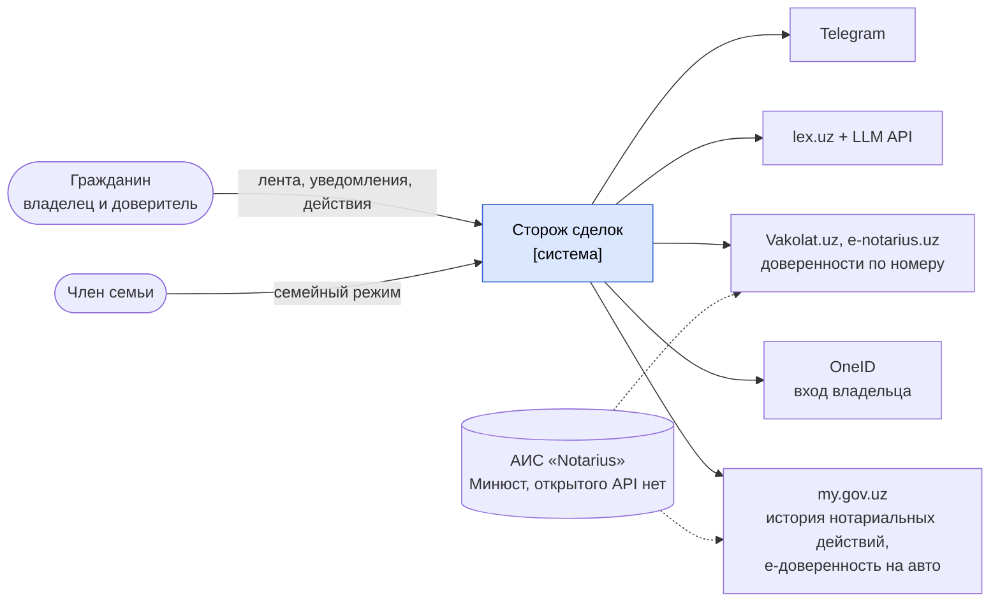
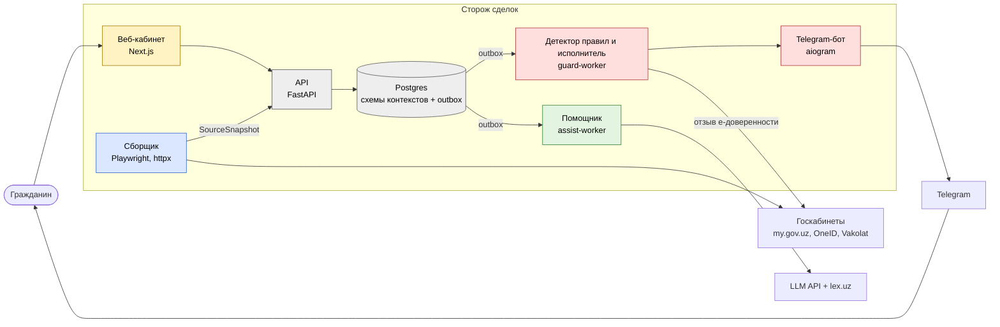
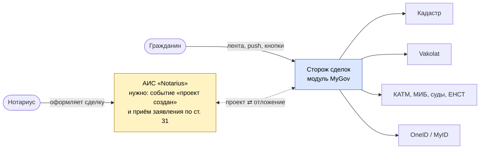
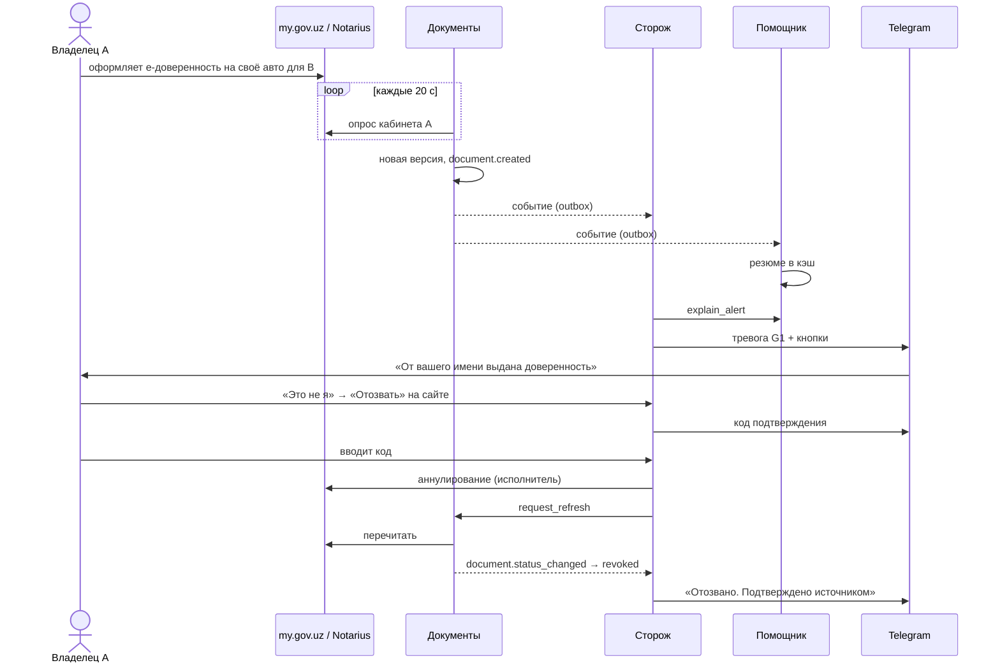
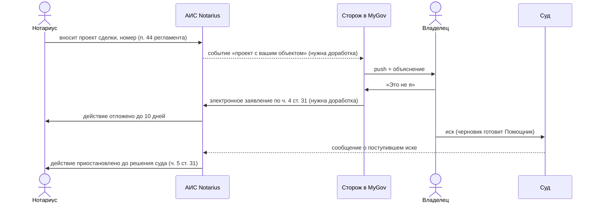

# Сторож сделок — общий документ проекта

Версия 1.1 · 21.11.2026 · LexHackathon 2026, трек 1, проблема 4

Один файл про весь проект: проблема, исследования и выводы, типы документов и реестры, архитектура, общие контракты, безопасность и демо. ТЗ разработчиков — отдельные файлы:

| Файл | Кому |
| --- | --- |
| `01-dev1-documents.md` | Разработчик 1 — «Документы» |
| `02-dev2-assistant-platform.md` | Разработчик 2 — «Помощник» и «Платформа» |
| `03-dev3-guard-frontend.md` | Разработчик 3 — «Сторож» и фронтенд MyGov |

Живые версии: [документ «Сторож сделок: архитектура»](https://claude.ai/artifact/ToQjusXFbSTbe8svf31pwh), [ТЗ в Claude Docs](https://claude.ai/artifact/B1Ee1aLxAT5QWZvrVkLnZF), [доска C4](https://claude.ai/artifact/9RpkLiFzFjZrWGKNk7qgvC).

## Содержание

1. О проекте и хакатоне
2. Проблема и решение
3. Три уровня продукта
4. Двусторонние документы: где хранятся и где их видно
5. Госреестры и системы
6. Как проходит сделка и где дыры
7. Исследования: что уже есть у государства и что ловим мы
8. Зарубежный опыт и правовая сторона
9. Архитектура
10. Общие контракты
11. Модель данных
12. Безопасность
13. Целевое состояние
14. Сборка и демо
15. Риски и вопросы к ментору
16. Источники

## 1. О проекте и хакатоне

| | |
| --- | --- |
| Хакатон | LexHackathon 2026, Министерство юстиции, ТГЮУ, 20–22 ноября 2026 |
| Трек и проблема | Трек 1, проблема 4: у граждан нет удобного механизма увидеть документы, оформленные на них |
| Чекпоинт | 21 ноября, 14:00–17:00, три ментора по 10 минут |
| Финал | 22 ноября, 7 минут: 3 мин питч + 2 мин демо + 2 мин вопросы |
| Оценка | (Техническая + Бизнес + Юридическая) ÷ 3 |
| Продукт | «Сторож сделок» (в команде также DocHub): модуль MyGov «Мои документы» |
| Принципы | Данные знают только государство и сам человек; продукт живёт только внутри контура MyGov; демо — на живых данных команды, не на моках |

Почему эта проблема, а не другие: проблема 3 трека 1 (медиация) отброшена, потому что система ADR Минюста запускается в декабре. Кредиты на чужое имя тоже не ядро: самозапрет и «Kredit xabarnoma» уже закрывают их (раздел 7).

## 2. Проблема и решение

**Проблема.** Нотариальные действия, доверенности, запреты и сделки с имуществом человека оформляются в разных госсистемах. Посмотреть их можно только поштучно, по запросу и после факта. О доверенности от своего имени или о продаже своей квартиры представителем владелец узнаёт, когда деньги уже ушли. Пример — [Gazeta.uz, 02.11.2026](https://www.gazeta.uz/oz/2026/11/02/apartment/): квартира за $85 000, запрет подан 13.10, попал в реестр 16.10, а сделка прошла 14.10 и через 4 дня объект перепродали по кадастровой цене 71,3 млн сумов.

**Сделку нужно ловить не в кадастре после регистрации, а в АИС «Notarius» между двумя моментами: когда нотариус внёс проект сделки и система присвоила ей номер, и когда нотариус её удостоверяет.** Это единственная точка, через которую обязательно проходит любая сделка с недвижимостью. С 1 апреля 2026 года именно нотариус через систему отправляет сделку на госрегистрацию. Когда сделка дошла до кадастра, деньги уже у продавца, а жертве остаётся суд.

Решение — модуль «сторож сделок» внутри госконтура (MyGov и Минюст) с четырьмя механизмами:

1. **Подтверждение владельца.** Если продаёт не сам владелец (через доверенность или наследника) или сделка набирает много рисковых признаков, владелец или наследники получают запрос и подтверждают сделку лицом через MyID. До ответа нотариус видит предупреждение.
2. **«Запрет в пути».** Как только прокуратура, суд или следователь приняли заявление о запрете, в банке запретов сразу появляется отметка «ожидается», а не через три дня. Именно это спасло бы семью из истории Gazeta.uz.
3. **Уведомления о событиях на имя человека:** доверенность от его имени, открыто наследственное дело, сменился собственник, появился запрет. Кнопка «Bu men emasman» («это не я») сразу готовит отзыв доверенности и заявления.
4. **Режим «только лично».** Владелец сам ставит отметку «никаких сделок без моего личного участия». В России такую отметку поставили более 400 тыс. человек. Особенно важно для пожилых и тех, кто живёт за границей.

Правила риска решают, когда нужно подтверждение. ИИ только объясняет событие простым языком и готовит документы, а сделку не блокирует. Так решение остаётся объяснимым и юридически чистым.

## 3. Три уровня продукта

**Государство уже показывает многие документы, но по одному, по запросу и в разных местах.** В MyGov есть отдельные «истории»: нотариальные действия, недвижимость, автомобиль, кредиты, ЭЦП. Каждая — отдельная заявка. «Историей нотариальных действий» воспользовались 333 тыс. раз (счётчик на странице услуги в MyGov): люди уже проверяют себя вручную.

| Уровень | Что получает человек | Что уже есть у государства | Наша добавка |
| --- | --- | --- | --- |
| 1. Агрегация | Один экран: все договоры и действия на моё имя из всех реестров, с историей изменений записи | Отдельные истории в MyGov, каждая по запросу. История недвижимости платная | Одна хронология по ПИНФЛ, версии записей |
| 2. Мониторинг | Уведомление о новом событии или изменении записи. ИИ-резюме документа и чат по нему с поиском по lex.uz | Есть только для кредитов (КАТМ), судебных заседаний (MyGov) и электронных доверенностей на авто | Нотариат, недвижимость, запреты, наследство, исполнительные надписи, трудоустройство |
| 3. Защита | Сразу отреагировать: отозвать, отложить, оспорить, подать заявление, подтвердить | Самозапрет на кредиты, онлайн-отзыв доверенности на авто | Отложение нотариального действия по ст. 31 Закона «О нотариате», готовые заявления |

## 4. Двусторонние документы: где хранятся и где их видно

**Почти всё, что касается собственности, проходит через нотариуса и попадает в «Notarius». Договоры без нотариуса разбросаны по другим реестрам или не хранятся у государства совсем.** «Проверено» — по официальному акту или статье со ссылкой. «Данные аналитика» — из списка команды, сам я эту услугу не открыл. Раздел «Видно в MyGov» стоит проверить ночью в своих кабинетах.

| Документ | Как оформляется и где хранится | Видно в MyGov | Где ещё посмотреть | Уведомление сейчас | Для нас |
| --- | --- | --- | --- | --- | --- |
| Купля-продажа, дарение, мена недвижимости | Нотариус → Notarius → реестр прав кадастра (проверено) | Да: «История нотариальных действий» (секунды, с 2019 года); «История недвижимости» — 198 тыс. сумов, 3 дня (данные аналитика) | e-notarius.uz, кадастр | Нет | Ядро |
| Договор долевого участия (новостройка) | С 01.07.2025 нотариально + регистрация в кадастре ([Spot.uz](https://www.spot.uz/oz/2026/11/17/property)) | В истории нотариальных действий (проверить) | Кадастр, «Shaffof qurilish» — про объект | Нет | Ядро: двойная продажа квартиры |
| Ипотека, залог недвижимости | Нотариус + банк; кредит в КАТМ | История нотариальных действий, кредитная история | Приложение КАТМ | По кредиту — да («Kredit xabarnoma») | Да, через нотариат |
| Купля-продажа, дарение авто | Нотариус + эскроу с 01.04.2026 ([Kun.uz](https://kun.uz/news/2026/10/27/avtomobil-oldi-sotdisini-qanday-rasmiylashtirish-mumkin-57973)), далее регистрация в МВД | История нотариальных действий; «Справка об истории автомобиля» | — | Нет | Да |
| Доверенность нотариальная | Notarius, автоматически в реестр Vakolat (проверено) | История нотариальных действий | e-notarius.uz и Vakolat.uz — по номеру | Нет | Ядро |
| Электронная доверенность на авто | my.gov.uz → Notarius + МВД ([регламент](https://www.lex.uz/docs/-6672128)) | Да, в кабинетах обеих сторон | — | Да, в кабинетах обеих сторон: при оформлении и отзыве | Демо: живая запись Notarius |
| Электронная доверенность Vakolat.uz | Реестр Vakolat (Минюст), срок до 3 лет (проверено) | Не проверено | Vakolat.uz — по номеру | Не найдено | Да |
| Брачный договор | Нотариус → Notarius | История нотариальных действий | — | Нет | Да |
| Соглашение об алиментах | Нотариус → Notarius | История нотариальных действий; долги — услуга МИБ | Приложение МИБ | Не проверено | Да |
| Завещание, наследство | Нотариус → Notarius. Сведения о завещании — только после смерти завещателя (ст. 6 Закона «О нотариате») | История — если ты сторона | e-notarius.uz — проверка наследственных дел | Не найдено | Да: наследникам при открытии дела |
| Заём и исполнительная надпись нотариуса | Нотариус → Notarius; надписи по долгам с 01.03.2026 (ПК-280) | История нотариальных действий (проверить, видна ли надпись должнику) | МИБ — когда дошло до исполнения | Не найдено | Да: должнику важно успеть возразить |
| Кредит, микрозайм | Банк, МФО → КАТМ (проверено) | Да: кредитная история, самозапрет | Приложение и сайт КАТМ | Да: «Kredit xabarnoma» с 16.03.2026 ([Gazeta.uz](https://www.gazeta.uz/oz/2026/03/30/credit/)) | Не ядро |
| Рассрочка (nasiya) | Компания рассрочки; передаётся ли в КАТМ — не проверено | Не проверено | Приложение продавца | Не проверено | Позже |
| Трудовой договор | Единая национальная система труда | Да: услуга получения договора, выписка из трудовой книжки (данные аналитика) | my.mehnat.uz | Нет: инспекция советует проверять самому ([Anhor.uz](https://anhor.uz/uzl/news/ozbekistonliklar-oz-roziligisiz-ishga-rasmiylashtirilganini-aniqladi/)) | Да: «оформили без согласия» |
| Аренда жилья | Регистрация в налоговой системе E-ijara (ijara.soliq.uz) | Услуги регистрации и проверки аренды (данные аналитика) | ijara.soliq.uz | Не найдено | Позже |
| Доля в ООО, смена учредителя или директора | Единый госреестр субъектов предпринимательства | Карточка компании (данные аналитика); история изменений — не проверено | Налоговый кабинет | Не найдено | Да: сигнал о смене состава |
| Договор с вузом | Система вуза (не проверено) | Не проверено | Кабинет студента | — | Нет |
| Медиативное соглашение | У сторон и медиатора, госреестра нет | Нет | — | — | Нет |

## 5. Госреестры и системы

**Все нужные данные уже сходятся в АИС «Notarius». Она интегрирована с 22 министерствами и 40 системами (слайд о нотариате на открытии), а банк запретов входит в неё.** Не хватает одного: канала от системы к владельцу.

| Система | Владелец | Что хранит и делает | Роль в нашем решении |
| --- | --- | --- | --- |
| АИС «Notarius» | Минюст | Все нотариальные действия с номерами, аудио- и видеозаписи, электронный архив (постановление КМ № 654 от 12.12.2023) | Источник событий и точка, где сделка ждёт подтверждения |
| Единый банк запретов | Минюст (внутри Notarius) | Запреты и аресты с 1 октября 2022 года. Данные вносят МВД, Кадастровое агентство и другие органы ([Spot.uz](https://www.spot.uz/oz/2022/08/24/property/)) | Новый статус «запрет ожидается» |
| Vakolat.uz | Минюст | Электронные доверенности сроком до 3 лет (постановление КМ № 825 от 25.12.2025), открытый реестр по номеру. Нотариальные доверенности попадают туда автоматически ([Anhor.uz](https://anhor.uz/uzl/news/elektron-ishonchnomalar-endi/)) | Событие «выдана доверенность от вашего имени» |
| e-notarius.uz | Минюст | Поиск нотариуса, очередь, проверка доверенностей и запретов | Страница настроек для гражданина |
| «ShAJARA» | Минюст | Электронное определение круга наследников (слайд о нотариате) | Кого уведомлять при открытии наследственного дела |
| Реестр прав на недвижимость | Кадастровое агентство | Кто владелец объекта. С 1 апреля 2026 года нотариус сам направляет туда сделки | Поиск владельца по кадастровому номеру |
| ЗАГС | Минюст | Смерть, брак, родство. Нотариус проверяет, жив ли доверитель | Родственники для режима «семья» |
| OneID | Минцифры | Единый вход: логин, ЭЦП, телефон, биометрия. 11,9 млн пользователей ([dgov.uz](https://dgov.uz/en/identification/)) | Вход владельца в настройки |
| MyID | Uzinfocom | Распознавание лица с проверкой «живой человек». Более 19 млн пользователей, есть Web, Mobile и Server SDK ([myid.uz](https://myid.uz/en/)) | Подтверждение сделки лицом владельца |
| my.gov.uz | Минцифры | Единый портал и приложение госуслуг | Основной канал уведомлений |
| Банки (эскроу) | Банки, ЦБ | Деньги покупателя до удостоверения, электронный обмен с нотариусом | В целевой версии: деньги не уходят продавцу, пока сделка оспаривается |
| Прокуратура, суды, следствие | Разные | Заявления и решения о запретах | Источник статуса «запрет ожидается» |

Обмен между ведомствами идёт через межведомственную интеграцию электронного правительства. Публичной документации по API АИС «Notarius», кадастра и банка запретов нет. Поэтому контракты ниже — наше предложение, а не описание существующих API. У MyID публичная документация есть (docs.myid.uz).

## 6. Как проходит сделка и где дыры

### Как сейчас проходит сделка с недвижимостью

**Нотариус проверяет продавца, доверенность, долги и запреты. Но человека, чья квартира продаётся, ни на одном шаге не спрашивают, если вместо него пришёл представитель.** Единственное SMS в процедуре приходит клиенту, который сидит у нотариуса: в нём сумма оплаты и код. Это антикоррупционная мера 2019 года, а не защита владельца ([Gazeta.uz](https://www.gazeta.uz/oz/2019/05/22/sms-xabar/)).

Шаги по административному регламенту нотариальных действий ([lex.uz, № 726 от 18.11.2020](https://lex.uz/mact/-5109530), с учётом [ПК-280](https://lex.uz/acts/-7722035)):

1. **Запись.** Лично или через my.gov.uz и e-notarius.uz, можно с предварительной подготовкой проекта (п. 5, 7–9).
2. **Личность.** С 1 января 2026 года оригинал паспорта не нужен: личность подтверждается отпечатком пальца и Face-ID (ПК-280, п. 3б). Дееспособность нотариус проверяет в беседе, при сомнении — в системе (п. 13–14).
3. **Полномочия представителя.** Доверенность с Vakolat.uz проверяется в системе. Дополнительно проверяется, нет ли записи о смерти доверителя в ЗАГСе и не отменена ли нотариальная доверенность (п. 16). Доверенности, заверенные в консульствах, начали попадать в систему только по плану июля 2026 года. Иностранные с апостилем остаются бумажными.
4. **Запросы через систему** (п. 22): кадастровая справка, долги в Бюро принудительного исполнения, налоги, коммуналка, прописка в МВД, согласие залогодержателя.
5. **Запреты и залоги** — проверка в едином банке запретов и реестре залогов (п. 40).
6. **Проект сделки вносится в систему и получает номер** (п. 41–44). С этого момента сделка существует в цифре. Это наша точка перехвата.
7. **Деньги.** С 1 апреля 2026 года покупатель кладёт деньги на эскроу-счёт. Нотариус в электронном виде проверяет, что деньги на месте, и только потом удостоверяет договор. После этого деньги уходят продавцу ([Kun.uz](https://kun.uz/news/2026/03/17/kochmas-mulk-va-transport-oldi-sotdisida-hisob-kitoblar-tartibi-belgilandi)).
8. **Оплата нотариусу.** SMS с суммой и кодом приходит клиенту, нотариус вводит код (п. 49).
9. **Подписание.** Отпечатки не менее двух пальцев, аудио- и видеозапись всей процедуры, удостовительная надпись с номером из системы и QR-код (п. 50–54).
10. **Регистрация права.** Нотариус сам направляет сделку в реестр и выдаёт выписку (п. 56). Данные о новом собственнике автоматически уходят в коммунальные службы (ПК-280, п. 7). Прежнему владельцу уведомление не приходит.

Что меняется дальше: по графику ПК-280 купля-продажа и дарение станут дистанционными к декабрю 2026 — марту 2027 года. Чем меньше личного присутствия, тем важнее, чтобы сделку подтверждал сам владелец.

### Где дыры

**Face-ID и отпечатки закрыли чужой паспорт. Открытыми остаются схемы, где перед нотариусом сидит настоящий человек, но не владелец:** представитель по доверенности, «наследник» или покупатель из цепочки перепродаж.

| Схема | Как работает | Что защищает сейчас | Что добавляет сторож |
| --- | --- | --- | --- |
| Поддельная или иностранная доверенность | Бумажная доверенность с апостилем или из консульства от владельца, живущего за границей | Нотариус проверяет бумагу | Владелец подтверждает сделку через MyID из любой страны |
| Ложный наследник, скрытые наследники | Дело оформляет один наследник, часто через представителя, остальные не знают | «ShAJARA» определяет круг наследников. Норма о недостойных наследниках, которые скрывают других, запланирована только к декабрю 2027 года (ПК-280, прил. 4, п. 10) | Уведомление всем наследникам из «ShAJARA» при открытии дела |
| Запрет опаздывает | Заявление уже в прокуратуре, а в реестре запрета ещё нет (история Gazeta.uz: 13.10 → 16.10, сделка 14.10) | Ничего | Статус «запрет ожидается» в день заявления |
| Быстрая цепочка перепродаж | Объект перепродают за дни, чтобы последний покупатель выглядел добросовестным. В договоре стоит кадастровая цена (в истории: 10.10 и 14.10, 71,3 млн сумов при реальных $85 000) | Ничего | Правила риска помечают сделку, нотариус и покупатель видят предупреждение |
| Чужой паспорт | Подставное лицо с документами владельца | Face-ID и отпечатки с 2026 года, видеозапись | Владелец всё равно получает уведомление, это запасной рубеж |
| Обманутый или зависимый пожилой владелец | Владелец приходит сам, но под давлением или по обману | Беседа о дееспособности | Режим «семья»: доверенный родственник получает копию уведомления. Эта защита частичная |
| Сговор с нотариусом | Нотариус закрывает глаза на нарушения | Видеозапись, лицензионные санкции | Уведомление уходит от системы, нотариус не может его отключить. Обходы фиксируются в журнале |

#### История из Gazeta.uz по шагам со сторожем

1. **Открытие наследственного дела через представителя.** Все наследники из «ShAJARA», включая женщину из Польши, получают уведомление. Спор начинается до продажи, а не после.
2. **Первая продажа 10.10 по доверенности от только что вступившего в права наследника.** Правила дают высокий риск, нужно подтверждение доверителя через MyID.
3. **Заявление о запрете 13.10.** В тот же день появляется статус «запрет ожидается».
4. **Вторая продажа 14.10.** Нотариус видит красный флаг: запрет ожидается, перепродажа через 4 дня, цена равна кадастровой. Семья сохраняет $85 000: деньги остаются на эскроу-счёте.

## 7. Исследования: что уже есть у государства и что ловим мы

**Государство уже многое показывает, но по запросу, поштучно и после факта. Наша уникальность — push до или сразу после события и кнопка, чтобы отреагировать.** Формула для питча: «История показывает, что у вас уже украли. Сторож предупреждает до того, как украдут».

### Что уже есть

| Что | Где | Как работает | Вывод для нас |
| --- | --- | --- | --- |
| «История нотариальных действий» | MyGov | С 2019 года, ответ за секунды, выбор года и арифметическая капча, только совершённые действия; 333 тыс. использований, рейтинг 4,86 | Главный источник Notarius для прототипа; ниша — push вместо ручного запроса |
| Истории: кредитная, авто, недвижимость, ЭЦП | MyGov | Каждая — отдельная заявка; история недвижимости 198 тыс. сумов, 3 рабочих дня (данные аналитика) | Агрегация и мониторинг в одном месте |
| Самозапрет на кредиты | MyGov / КИАЦ (КАТМ) | С 6 июня 2025 года, бесплатно, банки и МФО обязаны проверять; более 2,2 млн человек к 1 апреля 2026 | Кредиты закрыты — не ядро |
| «Kredit xabarnoma» | КАТМ | SMS/push сразу после кредитного договора, с 16 марта 2026, 4 614 сумов в год | Не дублируем |
| Статус жертвы мошенничества | Банки | С января 2026: банк приостанавливает проценты и взыскание | — |
| Электронная доверенность на авто | my.gov.uz | Регистрация в Notarius с QR, сразу в кабинеты заявителя, доверенного лица и МВД; онлайн-аннулирование бесплатно, уведомления обеим сторонам; пошлина 10% тарифа до месяца | Основа живого демо |
| Vakolat.uz | Минюст, КМ № 825 от 25.12.2025 | Электронные доверенности до 3 лет, публичный реестр по номеру; нотариальные попадают туда автоматически | Второй источник правды по доверенностям |
| Уведомления о суде | MyGov, с апреля 2026 | Гражданские, экономические, административные дела и дела об административных правонарушениях | Не дублируем |
| Прописка | MyGov, 2026 | Нужно согласие владельца через Face-ID / Mobile-ID | Уже под контролем |
| SIM-карты на паспорт | Операторы | Только USSD по запросу (Beeline *303#, Ucell *360#, Mobiuz *151#, Uzmobile *100*5#) | Не юридический документ |
| Долги, алименты, запрет на выезд, налоги | MyGov, МИБ, Soliq | Проверка по запросу; долги и алименты — 3,46 млн использований | Позже, как источники |
| Трудовой договор, выписка из трудовой | MyGov / ЕНСТ | По запросу | Источник для «оформили без согласия» |
| Аренда | E-ijara (ijara.soliq.uz) | Регистрация и проверка; обязательность не проверена | Позже |
| Didox | Частная B2B-система | Электронный документооборот компаний: счета-фактуры, акты, договоры | Не конкурент: не нотариат и не граждане |

### События, о которых государство само не сообщает

| Событие | Как узнаёт человек сейчас | Почему важно |
| --- | --- | --- |
| Нотариальное действие с тобой или от твоего имени | Сам запрашивает историю по годам | Ядро: поддельные доверенности и продажа жилья |
| Запрет или арест на твоё имущество | Проверка по объекту по запросу | История из Gazeta.uz |
| Открыто наследственное дело по родственнику | Никак, если не обратился сам (тайна по ст. 6) | Скрытые наследники |
| Исполнительная надпись нотариуса против тебя | Когда долг уже в МИБ | Надписи с 01.03.2026; по ПК-280 возражение должника должно их отменять |
| Тебя оформили на работу | Сам проверяет трудовую книжку | Около 1 500 случаев за первое полугодие 2026 |
| Сменились учредители или директор твоего ООО | Карточка компании по запросу | Захват компании |
| Использована твоя ЭЦП | «История ЭЦП» по запросу | Договоры и счета от твоего имени |

### Уровень 3: можно ли поставить сделку на паузу

**Пауза уже есть в законе, но владелец узнаёт о сделке слишком поздно.** Статья 31 Закона «О нотариате»: по заявлению заинтересованного лица действие откладывается однократно до 10 дней (ч. 4); если суд сообщит об иске — приостанавливается до решения (ч. 5); ст. 39 — обжалование в суде. Нужна доработка Notarius, а не новый закон: событие на этапе проекта и приём электронного заявления.

| Действие владельца | Доступно сегодня | Что нужно от Notarius |
| --- | --- | --- |
| Отозвать e-доверенность на авто | Да, онлайн в my.gov.uz, бесплатно | Ничего |
| Отозвать нотариальную доверенность | Через нотариуса; сторож готовит заявление | Онлайн-отзыв по образцу авто-доверенности |
| Отложить сделку на 10 дней | Юридически да, но о сделке не знает заранее | Событие на этапе проекта + приём заявления → автоматическое отложение |
| Приостановить до решения суда | По сообщению суда; сторож готовит черновик иска | Электронная связка суд → Notarius |
| Подтвердить сделку через MyID | Нет | Новая норма + доработка Notarius |

Для демо: вживую — чтение данных Notarius через MyGov и отзыв e-доверенности; пауза по ст. 31 — как целевое состояние с готовым заявлением. У ментора спросить тестовый доступ к Notarius.

## 8. Зарубежный опыт и правовая сторона

### Как это решили другие страны

**Уведомления владельцам и запрет сделок без личного участия уже работают у государственных реестров Великобритании, России и Казахстана.** Но везде одно и то же ограничение: уведомление приходит по заявлению на регистрацию или после неё, а сама сделка не ждёт ответа владельца.

| Страна | Механизм | Результат | Что берём |
| --- | --- | --- | --- |
| [Великобритания, Property Alert](https://www.gov.uk/guidance/property-alert) | Бесплатное письмо при любой заявке на изменение реестра по объекту. Можно следить за 10 объектами, в том числе за чужими, например родителей | За 2023/24 остановлено 97 попыток мошенничества на £58 млн. Сам сервис пишет, что не останавливает мошенничество автоматически | Режим «семья» и оповещение до регистрации |
| [Россия, запрет без личного участия](https://www.interfax.ru/russia/878989) | Запись в реестре: сделки по доверенности без владельца невозможны. С декабря 2022 года заявление подаётся через Госуслуги с электронной подписью, запись появляется за 5 рабочих дней | Более 400 тыс. заявлений | Режим «только лично» |
| [Казахстан, eGov](https://bizmedia.kz/2023-12-28-kazahstanskie-grazhdane-budut-poluchat-uvedomleniya-o-vazhnyh-izmeneniyah-kasayushhihsya-sfery-nedvizhimosti/) | Push и история в личном кабинете: регистрация прав, обременения, аресты, претензии (с конца 2023 года) | Статистика не найдена | Соседняя страна уже сделала уведомления — сильный аргумент для жюри |

Чем наш вариант сильнее: в Узбекистане все сделки с недвижимостью проходят через одну систему Минюста, а деньги покупателя лежат на эскроу до удостоверения. Значит, можно сделать не просто оповещение, а ожидание подтверждения до того, как деньги уйдут продавцу. Ни в одной из трёх стран такого нет.

### Правовая сторона

**Уведомления и предупреждения нотариусу можно запустить без нового закона. Для блокировки сделки до подтверждения владельца нужна норма.** Окно для неё открыто: ПК-280 (п. 11) поручил подготовить новый закон «О нотариате», а Минюст переутверждает регламенты под дистанционные сделки (п. 12).

| Этап | Что включаем | Основание | Что нужно |
| --- | --- | --- | --- |
| 1. Уведомления | Все пять событий, режим «семья», кнопка «Bu men emasman» | Человеку сообщают данные о нём самом, данные уже есть в системах Минюста. Режим «семья» — только с явного согласия владельца (Закон «О персональных данных», ЗРУ-547) | Решение Минюста и интеграция с my.gov.uz и приложением Минцифры |
| 2. Предупреждения нотариусу | Правила R3–R8 показываются как предупреждение. Нотариус фиксирует в системе, почему продолжает | Нотариус уже проверяет полномочия и запреты через систему (п. 16, 40 регламента) и при сомнении откладывает действие для проверки (п. 14) | Добавить в регламент проверку флагов сторожа |
| 3. «Запрет в пути» | Статус `ban.pending` в банке запретов | Банк запретов уже ведёт Минюст, а ПК-280 предусматривает инвентаризацию запретов (п. 9–10) | Соглашение с Генпрокуратурой, судами и МВД: отправлять отметку в день заявления |
| 4. Подтверждение владельца и «только лично» | Правила R1–R3 блокируют удостоверение | Обязательное подтверждение доверителя требует новой нормы. Но отложение на 10 дней по заявлению заинтересованного лица уже есть — ст. 31 Закона «О нотариате» | Норма в новом законе «О нотариате». Образец — российская запись о невозможности регистрации без личного участия |

Отдельно об ИИ. Модель получает тип события и сработавшие правила, а не ПИНФЛ и адрес. В целевой версии она работает внутри госконтура. Нормы об ответственности за обработку персональных данных с помощью ИИ стоит сверить с юристом команды, я их не проверял.

## 9. Архитектура

**Ядро не знает, откуда пришли данные: сегодня их приносит наш сборщик из кабинета, завтра — межведомственная интеграция MyGov.** Модульный монолит: один репозиторий и одна база, но у каждого контекста своя схема Postgres, свои эндпоинты и свои страницы. Связь между контекстами — только события и `public.py`.

Принципы:

1. **Порты и адаптеры.** Источник — адаптер за `SourceAdapter`, действие — адаптер за `ActionExecutor`, канал уведомлений — за `Notifier`, модель — за `LLMPort`. Новый реестр = новая папка в `adapters/`.
2. **Один вход данных.** Сборщик не пишет в базу, а шлёт `SourceSnapshot` в Ingestion API. В целевом состоянии тот же контракт шлёт шина межведомственной интеграции.
3. **Версии неизменяемы, события выводятся из их сравнения.** Версия, событие и запись outbox — одна транзакция; дубли отсекает `dedupe_key`.
4. **Действие только после подтверждения человека** по двум каналам, с ключом идемпотентности и проверкой результата по источнику.
5. **ИИ советует, но не действует.** Нет инструментов, нет доступа к базе, только обезличенный документ и статьи, ссылки проверяются.

### Контексты и команда

| Контекст | Отвечает за | Публикует | Получает | Владелец | ТЗ |
| --- | --- | --- | --- | --- | --- |
| **Документы** (`documents`) | Сессии OneID, адаптеры чтения, нормализация, версии, лента, карточка, «Источники» | `document.*`, `source.session_expired` | — | Разработчик 1 | `01-dev1-documents.md` |
| **Помощник** (`assistant`) | RAG по lex.uz, резюме, объяснение тревоги, чат, черновики заявлений, маскирование для LLM | `summary.ready` | `document.created`, `document.changed` | Разработчик 2 | `02-dev2-assistant-platform.md` |
| **Платформа** (`platform`, `shared`) | Общее ядро, вход, SSE, аудит, инфраструктура, CI | — | — | Разработчик 2 | `02-dev2-assistant-platform.md` |
| **Сторож** (`guard`) + каркас MyGov | Правила, тревоги, Telegram-бот, действия и исполнитель, семья; UI-кит и каркас | `alert.created`, `action.updated` | `document.*`, `source.session_expired` | Разработчик 3 | `03-dev3-guard-frontend.md` |

| Процесс | Контекст | Стек |
| --- | --- | --- |
| `api` | Все роутеры: `/documents`, `/sources`, `/guard`, `/assist`, `/auth`, `/me`, `/stream`, `/audit` | FastAPI, Pydantic v2, SQLAlchemy 2, Alembic |
| `collector` | Документы | Python 3.12, Playwright, httpx, APScheduler |
| `guard-worker`, `bot` | Сторож | Python, aiogram 3, Playwright |
| `assist-worker` | Помощник | Python, LLM API, эмбеддинги, pgvector, WeasyPrint |
| `web` | Каркас — Р3, страницы — каждый свои | Next.js 14 (App Router), TypeScript, Tailwind, TanStack Query, openapi-typescript, next-intl |
| `postgres` | Схемы `documents`, `guard`, `assistant`, `platform`, `shared` | Postgres 16 + pgvector |

Очередь — `shared.outbox` в Postgres, у каждого потребителя свой курсор; живые обновления — `LISTEN/NOTIFY` → SSE. Границы проверяет `import-linter` в CI и отдельная роль Postgres на контекст.

### C4 · Уровень 1 · Контекст системы: прототип



### C4 · Уровень 2 · Контейнеры: прототип



Цвет = контекст: синий — Документы, красный — Сторож, зелёный — Помощник, жёлтый — фронтенд, серый — общее.

### C4 · Уровень 1 · Целевое состояние: модуль внутри MyGov



### Последовательность живого демо



### Пауза по ст. 31: целевой поток



Доска с этими же диаграммами в C4: [«Сторож сделок — архитектура C4»](https://claude.ai/artifact/9RpkLiFzFjZrWGKNk7qgvC).

## 10. Общие контракты

**Пока контракты не влиты в `contracts/`, код не пишем.** После этого каждый работает независимо: фронтенд во время разработки берёт ответы из mock-сервера Prism по `openapi.yaml`, а на демо идёт только в живой API.

### URI документа

`uz:{реестр}:{тип}:{номер}`, например `uz:notarius:poa:{№}`. Номер — тот, что присвоил реестр. URI не меняется никогда, даже когда меняется статус. Таблица типов — на [доске](https://claude.ai/artifact/9RpkLiFzFjZrWGKNk7qgvC).

### Нормализованный документ

```json
{
  "uri": "uz:notarius:poa:{№}",
  "kind": "poa_car",
  "source": "mygov.car_poa",
  "title": "Доверенность на автомобиль",
  "status": "active",
  "owner_role": "principal",
  "parties": [
    {"role": "principal", "name_masked": "М***л А.", "pinfl_hash": "hmac…"},
    {"role": "agent", "name_masked": "Б***р К.", "pinfl_hash": "hmac…"}
  ],
  "object": {"type": "vehicle", "id_masked": "01 *** 45", "label": "марка и модель"},
  "issued_at": "2026-11-21",
  "valid_until": "2026-12-21",
  "issuer": {"type": "mygov", "name": "…"},
  "fields": {},
  "source_ref": {"external_id": "…", "url": "…"}
}
```

- `kind`: `notarial_act`, `poa_notarial`, `poa_car`, `ban`, `real_estate_right`, `vehicle`, `loan`, `enforcement_case`, `labor_contract`.
- `status`: `active`, `completed`, `revoked`, `expired`, `unknown`.
- `owner_role` — роль владельца кабинета в документе: `principal`, `agent`, `party`, `debtor`, `employee`. На ней стоят правила.
- ПИНФЛ, паспорт, номер авто и телефон в открытом виде сюда не попадают. Полные значения лежат зашифрованными в сыром снимке (см. «Безопасность»).
- Хеш версии = SHA-256 канонического JSON (ключи по алфавиту, без `source_ref.url`).

### Снимок источника

`POST /internal/ingest/snapshots` — единственный вход данных в систему, подпись HMAC-SHA256 в заголовке `X-Signature`.

```json
{
  "snapshot_id": "uuid",
  "citizen_id": "uuid",
  "source": "mygov.car_poa",
  "fetched_at": "2026-11-21T10:00:00+05:00",
  "complete": true,
  "documents": ["…нормализованные документы…"]
}
```

`complete: true` — в снимке весь список. Только тогда пропавшая запись считается событием `document.disappeared`, и то после двух снимков подряд.

### Событие

```json
{
  "id": "uuid",
  "type": "document.status_changed",
  "schema": "document.status_changed/v1",
  "producer": "documents",
  "subject": "uz:notarius:poa:{№}",
  "citizen_id": "uuid",
  "occurred_at": "…",
  "dedupe_key": "uri + version_no + type",
  "data": {"document_id": "uuid", "version_no": 3, "prev_version_no": 2,
           "changed_fields": ["status"], "status_from": "active", "status_to": "revoked"}
}
```

Схемы версионируются (`/v1`): новое поле — можно, удалить или переименовать — только через `/v2`.

### Порты между контекстами

```python
# documents/ports.py — адаптер источника
class SourceAdapter(Protocol):
    source_id: str                 # "mygov.car_poa"
    poll_interval_s: int
    async def fetch(self, session: BrowserSession) -> list[RawRecord]: ...
    def normalize(self, raw: RawRecord) -> NormalizedDocument: ...

# documents/public.py — что отдаём другим
class SessionProvider(Protocol):
    @asynccontextmanager
    async def get(self, citizen_id: UUID, provider: str = "oneid") -> AsyncIterator[BrowserSession]: ...
async def get_document(document_id: UUID) -> NormalizedDocument: ...
async def request_refresh(document_id: UUID) -> None: ...

# guard/ports.py — действие
class ActionExecutor(Protocol):
    action_type: str               # "revoke_car_poa"
    async def execute(self, req: ActionRequest, session: BrowserSession) -> ActionResult: ...

# assistant/public.py
async def summarize(doc: NormalizedDocument, lang: Lang) -> Summary: ...
async def explain_alert(rule_id: str, doc: NormalizedDocument, lang: Lang) -> str | None: ...
async def draft_application(type: Literal["art31_postpone", "court_claim"], document_id: UUID, citizen_id: UUID) -> DraftRef: ...
```

### API: сводка

| Контекст | Пути | Подробно |
| --- | --- | --- |
| Документы | `/documents`, `/documents/{id}`, `/documents/{id}/versions`, `/documents/{id}/versions/{n}/diff`, `/sources`, `/internal/ingest/snapshots`, `/internal/documents/{id}/refresh` | `01-dev1-documents.md`, раздел 8 |
| Сторож | `/guard/alerts`, `/guard/actions`, `/guard/actions/{id}/confirm`, `/guard/drafts`, `/guard/telegram/link`, `/guard/family`, `/guard/consents/*` | `03-dev3-guard-frontend.md`, раздел 8 |
| Помощник | `/assist/documents/{id}/summary`, `/assist/chat` | `02-dev2-assistant-platform.md`, раздел 8 |
| Платформа | `/auth/telegram/start`, `/auth/callback`, `/auth/logout`, `/me`, `/stream`, `/audit`, `/audit/verify` | `02-dev2-assistant-platform.md`, раздел 8 |

Общие правила: ошибки — `application/problem+json` (RFC 9457), списки — курсорная пагинация, все ответы несут `X-Request-Id`, POST с побочным эффектом принимает `Idempotency-Key`. Во время разработки фронтенд берёт ответы из Prism по `contracts/openapi.yaml`, на демо — только живой API.

### События: сводка

| Событие | Публикует | Потребляют |
| --- | --- | --- |
| `document.created`, `document.changed` | Документы | Сторож, Помощник |
| `document.status_changed`, `document.disappeared` | Документы | Сторож |
| `source.session_expired` | Документы | Сторож |
| `alert.created`, `action.updated` | Сторож | Браузер (SSE) |
| `summary.ready` | Помощник | Браузер (SSE) |

## 11. Модель данных

**Пять схем, у каждой свой хозяин. Между схемами нет внешних ключей, только UUID.** Таблицы версий, outbox и аудита только дописываются. RLS по `citizen_id` везде. Подробные поля — в ТЗ владельца.

| Схема | Таблицы | Владелец |
| --- | --- | --- |
| `documents` | `sources`, `source_sessions`, `documents`, `document_versions`, `snapshots` | Разработчик 1 |
| `guard` | `alerts`, `actions`, `telegram_links`, `link_tokens`, `consents`, `invite_codes` | Разработчик 3 |
| `assistant` | `lex_chunks`, `summaries`, `chat_messages`, `drafts` | Разработчик 2 |
| `platform` | `citizens`, `web_sessions`, `login_nonces` | Разработчик 2 |
| `shared` | `outbox`, `consumer_offsets`, `audit_log` | Разработчик 2 |

## 12. Безопасность

**Два правила сильнее всех остальных: в нашем интерфейсе нет поля для пароля OneID, и ни одно действие не выполняется без кода, который человек получил по другому каналу.** Вход в OneID человек делает сам на настоящем id.egov.uz в окне браузера сборщика, мы сохраняем только зашифрованную сессию. Это же ответ жюри на вопрос «а чем вы отличаетесь от фишинга».

|  Риск | Мера в прототипе | В целевом состоянии |
|  --- | --- | --- |
|  Утечка данных входа OneID | Пароль и SMS-код вводятся только на id.egov.uz (`storozh connect` открывает видимый Chromium). Храним только storage state, зашифрованный | Сессии нет: данные приходят по межведомственной интеграции |
|  Кража базы | Конвертное шифрование AES-256-GCM: у каждого гражданина свой ключ данных, он зашифрован мастер-ключом из окружения. Шифруем `state_enc`, `raw_enc`, `pinfl_enc`, `chat_id_enc`. Удалили ключ — данные человека нечитаемы | Мастер-ключ в HSM государственного центра данных |
|  Лишние персональные данные | В `payload` только маски и HMAC; ПИНФЛ ищем по HMAC с отдельным ключом | То же |
|  Чужие данные по ошибке в запросе | Row-Level Security в Postgres: каждая таблица фильтруется по `app.citizen_id` из сессии, даже если в коде забыли `WHERE` | То же |
|  Чужой вход в кабинет сторожа | Одноразовая ссылка из бота: 32 байта, 5 минут, одно использование. Cookie `__Host-`, `HttpOnly`, `Secure`, `SameSite=Strict`, проверка `Origin` на всех POST | Вход через OneID, модуль внутри MyGov |
|  Действие без воли человека | Два шага: `POST /guard/actions` → 6-значный код в Telegram (в базе хеш, 2 минуты, 3 попытки) → `confirm`. Ключ идемпотентности. Исполнитель знает только типы из белого списка | Подтверждение лицом через MyID |
|  Поддельное нажатие кнопки в Telegram | `callback_data` подписан HMAC, `chat_id` сверяется с привязкой | Push MyGov вместо Telegram |
|  Фишинг под наши уведомления | В тексте тревоги нет персональных данных и нет ссылок на вход. Единственная ссылка ведёт на карточку на нашем домене | Уведомления только в приложении MyGov |
|  Поддельный снимок или повтор запроса | Внутренние эндпоинты: HMAC-подпись + метка времени (окно 5 минут) + `snapshot_id` один раз; наружу не опубликованы | mTLS между сервисами |
|  Инъекция инструкций в тексте документа для ИИ | У модели нет инструментов. Текст документа идёт отдельным блоком данных. Ссылки в ответе проверяются: статья, которой нет среди найденных фрагментов, вырезается | То же |
|  Персональные данные в LLM | Модуль `assistant/pii` заменяет ПИНФЛ, паспорт, телефон, госномер и ФИО на метки до отправки | Модель развёрнута в центре данных в Узбекистане |
|  Незаметная правка истории | `audit_log` с цепочкой хешей: входы, действия, каждый просмотр данных родственника. Эндпоинт проверки цепочки | То же |
|  Блокировка аккаунта слишком частыми запросами | Одна сессия на аккаунт, лимит по источнику, случайный разброс интервала, экспоненциальная пауза при ошибках | Не нужно |
|  Персональные данные в логах и секреты в git | structlog-процессор маскирует ПИНФЛ и токены. `gitleaks` в pre-commit, секреты только в `.env` | Секреты в Vault |
|  Веб-атаки на модалку подтверждения | Строгий CSP, HSTS, `frame-ancestors 'none'`, запрет встраивания в iframe | То же |
|  Уязвимые зависимости | Версии зафиксированы, `pip-audit` и `npm audit` в CI | То же |

Локализация данных: с 27 марта 2026 года биометрические и генетические данные граждан обязаны храниться в Узбекистане, остальные можно хранить за рубежом при условиях ([Kun.uz](https://kun.uz/ru/news/2026/03/28/xraneniye-nekotoryx-personalnyx-dannyx-za-predelami-uzbekistana-razresheno)). Мы в целевом состоянии держим всё в госконтуре, включая модель.

Владелец каждой меры указан в ТЗ разработчиков.

## 13. Целевое состояние

### Что меняется при переезде в MyGov

**При переезде меняются адаптеры на краях, а доменный код трёх контекстов остаётся как есть.** Это таблица для вопроса жюри «а как это будет работать на всю страну».

| Что | Прототип | Внутри MyGov |
| --- | --- | --- |
| Источники | Playwright по кабинету человека | Подписка на события реестров через межведомственную интеграцию, тот же `SourceSnapshot` |
| Notarius | Только совершённые действия из истории | Событие «проект сделки создан» и приём заявления по ст. 31 — надо доработать на стороне Минюста |
| Вход | Одноразовая ссылка из Telegram | OneID, модуль внутри портала |
| Уведомления | Telegram-бот | Push и входящие MyGov |
| Подтверждение действия | Код в Telegram | MyID по лицу |
| ИИ | LLM API | Модель в центре данных в Узбекистане |
| Очередь | `shared.outbox` в Postgres | Kafka; контракт событий тот же |
| Развёртывание | Модульный монолит, `docker compose` | Контексты — отдельные сервисы с своими базами (схемы уже разделены) |
| Масштаб | Один экземпляр | API без состояния — горизонтально; воркеры делятся по хешу гражданина; `document_versions` и `outbox` партиционируются по месяцам |
| Ключи и секреты | Мастер-ключ из `.env` | HSM и Vault в государственном центре данных |

### Контракты с Notarius, которые мы предлагаем

**Сторож слушает пять событий и отвечает на один синхронный запрос нотариуса.** Форматы данных ниже предлагаем мы: реальные схемы АИС «Notarius» не публикуются.

#### События, которые слушаем

| Событие | Источник | Кому уходит уведомление |
| --- | --- | --- |
| `poa.issued` — выдана доверенность | Vakolat.uz, Notarius, консульства | Доверителю, с кнопкой «отозвать» |
| `inheritance.opened` — открыто наследственное дело | Notarius, «ShAJARA» | Всем наследникам из «ShAJARA» |
| `ban.pending` — подано заявление о запрете | Прокуратура, суд, следствие | Владельцу. Нотариус видит красный флаг |
| `deal.drafted` — проект сделки получил номер | Notarius (п. 44 регламента) | Владельцу и родственникам из режима «семья». Если риск высокий, нужно подтверждение |
| `owner.changed` — право зарегистрировано | Кадастр | Прежнему и новому владельцу |

Пример события `deal.drafted`:

```json
{
  "type": "deal.drafted",
  "deal_id": "NOT-2026-0142877",
  "notary_id": "N-0318",
  "act": "real_estate_sale",
  "object": { "cadastre_no": "10:07:03:01:02:0045", "kind": "apartment" },
  "parties": [
    { "role": "seller_representative", "pinfl": "3…", "biometric_ok": true },
    { "role": "buyer", "pinfl": "5…", "biometric_ok": true }
  ],
  "basis": { "poa_id": "VK-2026-88120", "poa_origin": "foreign_apostille" },
  "price_declared": 71300000,
  "escrow_ref": "ESC-0099812",
  "created_at": "2026-11-21T10:14:00+05:00"
}
```

#### API сторожа

| Вызов | Кто вызывает | Что делает |
| --- | --- | --- |
| `POST /v1/checks` | Notarius при `deal.drafted` | Синхронно возвращает `risk_level`, `reasons[]`, `consent_required` и `check_id`. Бюджет ответа — до 2 секунд |
| `GET /v1/checks/{id}` | Notarius перед удостоверением | Статус: `pending`, `approved`, `denied` или `expired` |
| `POST /v1/consents/{id}/decision` | Приложение владельца после MyID | `approve` или `deny` + идентификатор проверки MyID |
| `POST /v1/subscriptions` | Владелец | Режим «семья»: кто ещё получает копии уведомлений. Согласие подтверждается через MyID |
| `POST /v1/in-person-only` | Владелец | Режим «только лично» на один объект или на всё имущество |
| `POST /v1/incidents` | Кнопка «Bu men emasman» | Отзыв доверенности, заявления в полицию и нотариальную палату, запрос запрета на отчуждение |

#### Правила риска (первая версия)

| Правило | Условие | Результат |
| --- | --- | --- |
| R1 | На объект есть `ban.pending` | Блок: нотариус не удостоверяет |
| R2 | У владельца включён режим «только лично», а продаёт представитель | Блок |
| R3 | Продаёт представитель по доверенности | Нужно подтверждение доверителя через MyID |
| R4 | Доверенность бумажная, консульская или с апостилем, или выдана меньше 30 дней назад | Высокий риск |
| R5 | Право продавца получено по наследству меньше 12 месяцев назад | Высокий риск + уведомление наследникам |
| R6 | Объект перепродаётся меньше чем через 90 дней | Средний риск |
| R7 | Цена в договоре равна кадастровой или ниже, а сумма на эскроу заметно больше | Средний риск, предупреждение покупателю |
| R8 | Владельцу 70 лет или больше | Копия уведомления родственникам из режима «семья» |

Пороги (30 дней, 12 месяцев, 90 дней, 70 лет) — стартовые значения. Их нужно настроить по истории спорных сделок. Каждое срабатывание пишется в журнал с причиной. ИИ пишет объяснение для человека, но решение о блоке не принимает.

#### Правила безопасности уведомлений

- **Никаких ссылок в SMS.** SMS только сообщает «откройте my.gov.uz». Иначе мошенники начнут рассылать поддельные «уведомления о сделке».
- **Минимум данных в тексте:** ни адреса, ни суммы. Подробности только после входа через OneID.
- **Подтверждение только лицом** через MyID с проверкой «живой человек», а не кодом из SMS: код легко выманить.

## 14. Сборка и демо

**Три общие сборки. Каждая заканчивается прогоном на живом аккаунте, а не словами «у меня работает».**

1. **Контракты, втроём.** `openapi.yaml`, схемы событий, `NormalizedDocument`, пустые модули контекстов. Проверка: `docker compose up` поднимает всё, Prism отвечает по контракту, `import-linter` зелёный.
2. **Сборка 1 — сквозной поток.** Настоящая e-доверенность появляется в ленте → срабатывает G1 → в Telegram приходит тревога с шаблонным текстом. Дизайн пока любой.
3. **Сборка 2 — защита.** «Это не я» → код → отзыв в my.gov.uz → статус «отозвана» в ленте. ИИ-резюме в карточке и объяснение в тревоге.
4. **Сборка 3 — чистовик.** Дизайн MyGov 1:1, чат по lex.uz, страница «Источники», семья, история нотариальных действий. Проверка: демо проходит три раза подряд с нуля. Один из прогонов записываем на видео на случай, если на сцене ляжет my.gov.uz.

#### Демо на живых данных

А — владелец авто, его Telegram выведен на экран. Б — второй участник команды. Доска: раздел «Живое демо» на [архитектурной доске](https://claude.ai/artifact/9RpkLiFzFjZrWGKNk7qgvC).

1. Открываем «Мои документы» А: лента из нескольких реестров, в «Источниках» — «последний опрос 8 с назад».
2. А на сцене оформляет в my.gov.uz доверенность на своё авто для Б. Это изображает мошенника.
3. До 30 секунд: доверенность в ленте, в Telegram у А — «От вашего имени выдана доверенность» и объяснение ИИ.
4. А открывает карточку: резюме и вопрос в чат «что Б может сделать с моей машиной?» — ответ со ссылкой на статью.
5. «Это не я — отозвать» → код из Telegram → экран хода действия.
6. Статус «Подтверждено источником: отозвана». Б показывает залу свой кабинет my.gov.uz — доверенности больше нет.
7. Фраза для перехода к целевому состоянию: «Для нотариальной сделки то же самое делает ст. 31 — нужно только событие из Notarius до удостоверения».

Заранее: у А есть авто на его имя, оплачена пошлина за оформление, сессии OneID А и Б подключены через `storozh connect`.

## 15. Риски и вопросы к ментору

**Главный риск тот же, что с медиацией: Минюст может уже делать что-то похожее.** В открытых источниках уведомлений владельцам нет, и в ПК-280 их тоже нет. Но это нужно спросить напрямую, до того как вкладывать ночь.

#### Спросить сегодня

- [ ] Есть ли у Минюста планы уведомлять владельцев о сделках и доверенностях из АИС «Notarius»?
- [ ] Через сколько запрет прокуратуры или суда обычно попадает в банк запретов? История из Gazeta.uz — исключение или норма?
- [ ] Дадут ли на хакатоне схему данных или тестовый доступ к Notarius, Vakolat.uz и банку запретов? По Низому это возможно.
- [ ] Насколько реально внести подтверждение владельца в новый закон «О нотариате»? Или достаточно поправки в регламент?
- [ ] Какие схемы мошенничества чаще всего видит нотариальная палата? Это нужно, чтобы приоритезировать правила R1–R8.

#### Риски решения

| Риск | Что делаем |
| --- | --- |
| Ложные срабатывания тормозят честные сделки | Блок только по R1–R3, остальное — предупреждение. Владелец может подтвердить заранее, при выдаче доверенности |
| Владелец без смартфона или пожилой | Подтверждение у любого нотариуса или в центре госуслуг по отпечатку пальца; режим «семья» |
| Поддельные уведомления от мошенников | Без ссылок в SMS, действия только в официальном приложении |
| Сторож недоступен, нотариусы встали | При отказе сервиса сделки с R1–R3 ждут, остальные проходят с отметкой «не проверено» и последующим уведомлением |
| Жюри: «но это же на моках» | Демо на живых данных: настоящая доверенность в Notarius оформляется и отзывается прямо на сцене |

## 16. Источники

- [Административный регламент нотариальных действий, № 726 от 18.11.2020 — lex.uz](https://lex.uz/mact/-5109530)
- [ПК-280 от 09.09.2025 о развитии нотариата — lex.uz](https://lex.uz/acts/-7722035)
- [Gazeta.uz: что меняется в нотариате с 2026 года, 11.09.2025](https://www.gazeta.uz/oz/2025/09/11/notarius/)
- [Gazeta.uz: SMS от нотариуса, 22.05.2019](https://www.gazeta.uz/oz/2019/05/22/sms-xabar/)
- [Kun.uz: расчёты через эскроу с 1 апреля 2026, 17.03.2026](https://kun.uz/news/2026/03/17/kochmas-mulk-va-transport-oldi-sotdisida-hisob-kitoblar-tartibi-belgilandi)
- [Gazeta.uz: семья теряет квартиру из-за запрета, 02.11.2026](https://www.gazeta.uz/oz/2026/11/02/apartment/)
- [Spot.uz: единый банк запретов, 24.08.2022](https://www.spot.uz/oz/2022/08/24/property/)
- [Anhor.uz: Vakolat.uz, 27.12.2025](https://anhor.uz/uzl/news/elektron-ishonchnomalar-endi/)
- [MyID](https://myid.uz/en/)
- [OneID — dgov.uz](https://dgov.uz/en/identification/)
- [HM Land Registry: Property Alert](https://www.gov.uk/guidance/property-alert)
- [Interfax: запрет сделок без личного участия через Госуслуги](https://www.interfax.ru/russia/878989)
- [Bizmedia.kz: уведомления о недвижимости в eGov, 28.12.2023](https://bizmedia.kz/2023-12-28-kazahstanskie-grazhdane-budut-poluchat-uvedomleniya-o-vazhnyh-izmeneniyah-kasayushhihsya-sfery-nedvizhimosti/)
- Слайд «Notariat» с открытия хакатона: 22 министерства и 40 систем в интеграции, «ShAJARA», постановление КМ № 654

Добавлено 21 ноября:

- [Закон «О нотариате» — ст. 6, 31, 39](https://www.lex.uz/acts/57043)
- [Регламент электронной доверенности на авто через my.gov.uz](https://www.lex.uz/docs/-6672128)
- [Gazeta.uz — «Kredit xabarnoma»](https://www.gazeta.uz/oz/2026/03/30/credit/)
- [Advice.uz — уведомления о судебных заседаниях в MyGov](https://advice.uz/oz/news/3161)
- [Spot.uz — прописка с согласия владельца](https://www.spot.uz/oz/2026/05/07/citizens-live/)
- [Spot.uz — долевое строительство через нотариуса и кадастр](https://www.spot.uz/oz/2026/11/17/property)
- [Kun.uz — купля-продажа авто и эскроу](https://kun.uz/news/2026/10/27/avtomobil-oldi-sotdisini-qanday-rasmiylashtirish-mumkin-57973)
- [Anhor.uz — трудоустройство без согласия](https://anhor.uz/uzl/news/ozbekistonliklar-oz-roziligisiz-ishga-rasmiylashtirilganini-aniqladi/)
- [Anhor.uz — SIM-карты на паспорт](https://anhor.uz/uz/news/pasportingizda-ajsi-telefon-ra-amlari-r-jhatga-olinganini-tekshirish-mumkin/)

- [Kun.uz — локализация персональных данных с 27.03.2026](https://kun.uz/ru/news/2026/03/28/xraneniye-nekotoryx-personalnyx-dannyx-za-predelami-uzbekistana-razresheno)
