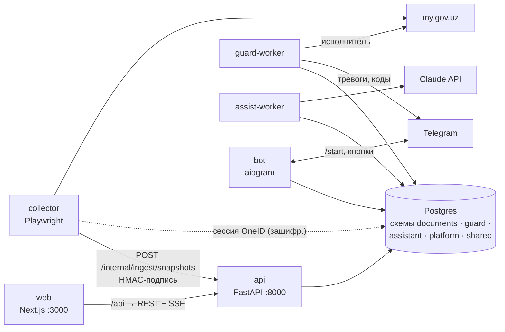
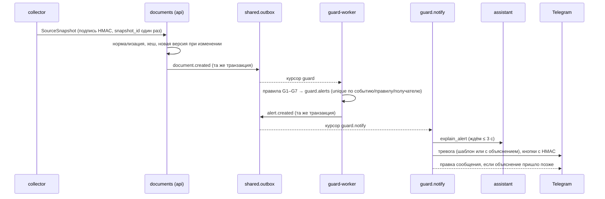
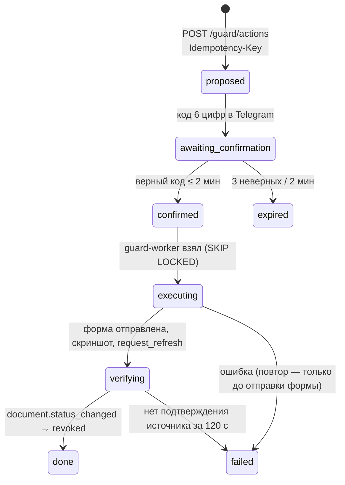

# Сторож сделок — техническая архитектура

Состояние на 21.11.2026. Описывает код, который лежит в репозитории, а не только план. Подробные ТЗ —
`00-project-overview.md` (§9–13) и `01/02/03-*.md`; ход работ «Сторожа» — `03-dev3-STATUS.md`.

## 1. Коротко

**Модульный монолит: один репозиторий, один Postgres, четыре контекста с жёсткими границами.** Контекст —
это своя схема и своя роль в базе, свои эндпоинты, свои воркеры и свои страницы. Друг с другом контексты
говорят только событиями через `shared.outbox` и функциями из `<context>/public.py`. Ядро не знает, откуда
пришли данные: сегодня их приносит наш сборщик из кабинета человека, в целевом состоянии — межведомственная
интеграция MyGov по тому же контракту.

| Слой | Технологии |
| --- | --- |
| API и воркеры | Python 3.12, FastAPI, Pydantic v2, psycopg 3 (без ORM), uv |
| Сборщик | Playwright (DOM кабинетов MyGov, my.soliq.uz, birdarcha), httpx |
| Бот | aiogram 3 (long polling) |
| ИИ | Claude через Anthropic SDK, эмбеддинги sentence-transformers, pgvector, WeasyPrint для PDF |
| База | Postgres 16 + pgvector, миграции — plain SQL по папке на контекст |
| Веб | Next.js 15 (App Router), React 19, TypeScript, Tailwind, TanStack Query, openapi-fetch + типы из `openapi.yaml` |
| Инфра | docker compose (dev и prod), GitHub Actions: CI → автодеплой на `justina.clusteros.co.uz` |

## 2. Контексты

| Контекст | Код | Отвечает за | Публикует | Слушает |
| --- | --- | --- | --- | --- |
| **Документы** (Р1) | `storozh/documents/` | Сессии OneID, адаптеры источников, нормализация, неизменяемые версии, лента, карточка, «Источники» | `document.created/changed/status_changed/disappeared`, `source.session_expired` | — |
| **Помощник** (Р2) | `storozh/assistant/` | RAG по lex.uz (гибридный поиск), резюме документа, объяснение тревоги, чат со ссылками, PDF-заявления, маскирование ПДн перед моделью | `summary.ready` | `document.created/changed` |
| **Платформа** (Р2) | `storozh/platform/`, `storozh/shared/` | Вход через Telegram, граждане, `/me`, SSE `/stream`, журнал аудита; общее ядро | — | — |
| **Сторож** (Р3) | `storozh/guard/` | Правила G1–G7, тревоги, Telegram-бот, действия с подтверждением, исполнитель отзыва, семья | `alert.created`, `action.updated` | `document.*`, `source.session_expired`, свой `alert.created` (G7), `action.updated` (уведомления) |

Каждый контекст устроен одинаково (порты и адаптеры):

```
<context>/
  domain/      чистая логика без базы и сети (правила, автомат состояний, нормализация)
  ports.py     протоколы на краях: SourceAdapter, ActionExecutor, Notifier, LLMPort
  adapters/    реализации портов: источники, Telegram, исполнители, SQL (adapters/db)
  service.py   сценарии: транзакции, события, вызовы портов
  api.py       HTTP-роутер (пути строго по contracts/openapi.yaml)
  worker.py    фоновый процесс: потребитель outbox и циклы
  public.py    единственное, что можно импортировать другим контекстам
```

## 3. Процессы



| Процесс | Запуск | Что делает |
| --- | --- | --- |
| `api` | `python -m storozh api` | Все роутеры: `/documents`, `/sources`, `/guard`, `/assist`, `/auth`, `/me`, `/stream`, `/audit`, `/internal/ingest` |
| `collector` | `python -m storozh worker collector` | Опрашивает источники сессией человека, шлёт `SourceSnapshot` в Ingestion API |
| `guard-worker` | `python -m storozh worker guard` | 4 цикла: правила (`guard`), уведомления (`guard.notify`), исполнение действий + таймауты, суточная проверка G4 |
| `bot` | `python -m storozh worker bot` | Telegram: привязка, вход, кнопки тревог |
| `assist-worker` | `python -m storozh worker assistant` | Резюме новых версий документов в фоне |
| `migrate` | `python -m storozh migrate` | Применяет `migrations/<context>/NNN_*.sql` по порядку, сверяет checksum |

## 4. Поток данных

### 4.1 От кабинета до тревоги



**Один вход данных.** Сборщик не пишет в чужие таблицы: он отправляет снимок в `POST /internal/ingest/snapshots`
с HMAC-подписью и меткой времени. Документ уникален по `(citizen_id, uri)`; версии только дописываются,
события выводятся сравнением версий. Версия, событие и запись outbox — одна транзакция.

### 4.2 Действие «Это не я → отозвать»



Каждый переход — одна транзакция: строка в `action_steps`, запись в `audit_log`, событие `action.updated`
(`{action_id}:{status}`). Переходы только вперёд, запись оптимистичная (`UPDATE … WHERE status = <ожидаемый>`).
`done` ставится только по данным источника, а не по ответу исполнителя.

## 5. Шина событий: `shared.outbox`

Вместо брокера — таблица в Postgres с контрактом как у Kafka (тип, `subject`, `citizen_id`, `dedupe_key`,
JSON по схеме из `contracts/events/`).

- **Публикация** — в транзакции изменения данных; повтор `dedupe_key` возвращает прежнее событие.
  Порядок `seq` совпадает с порядком коммитов (advisory lock на запись).
- **Потребление** — у каждого потребителя свой курсор в `shared.consumer_offsets`. Обработчик получает
  `(event, conn)`: его записи коммитятся вместе со сдвигом курсора. Строка курсора берётся
  `FOR UPDATE SKIP LOCKED`, два экземпляра не обработают одно событие.
- **Доставка «хотя бы раз»**: обработчики идемпотентны (уникальные ключи тревог, `tg_message_id`,
  `dedupe_key`). Ошибка — откат, пауза 5 с, повтор того же события.
- **Живые обновления** — `pg_notify` после коммита → `/stream` (SSE) → TanStack Query на фронте.

| Событие | Кто публикует | `dedupe_key` | Кто слушает |
| --- | --- | --- | --- |
| `document.created/changed/status_changed` | documents | `{citizen_id}:{uri}:{версия}:created\|changed\|status` | guard, assistant |
| `document.disappeared` | documents | `{citizen_id}:{uri}:{snapshot_id}:gone` | guard (G5) |
| `source.session_expired` | documents | `{citizen_id}:{provider}:{время}` | guard (G6) |
| `alert.created` | guard | `{event_id}:{rule_id}` (у копий G7 — `…:{получатель}`) | guard (G7), guard.notify, SSE |
| `action.updated` | guard | `{action_id}:{status}` | guard.notify, SSE |
| `summary.ready` | assistant | `{document_id}:{версия}:{lang}` | SSE |

## 6. Данные

Схема на контекст: `documents`, `guard`, `assistant`, `platform`, `shared`. Каждое соединение делает
`SET ROLE storozh_<context>` и `search_path = <context>, shared`; роль имеет права только на свою схему —
запрос в чужую таблицу падает с `permission denied`, даже если его кто-то написал.

Схема `guard` (миграции `001`–`003`):

| Таблица | Назначение |
| --- | --- |
| `alerts` | Тревоги: правило и версия, важность, заголовок, объяснение ИИ, кнопки, вердикт, статус, `tg_message_id`. Уникальность `(event_id, rule_id, citizen_id)` |
| `actions`, `action_steps` | Действия и их ход. `idempotency_key` unique, одно открытое действие на документ+тип, хеш кода, попытки, `submitted_at`, зашифрованный скриншот |
| `poa_watch` | Доверенности, которые видел guard (для G4 и проверки прав): документ, гражданин, срок, статус |
| `telegram_links`, `link_tokens` | Привязка чата: `chat_id` зашифрован, поиск по HMAC; одноразовые токены привязки (хеш) |
| `consents`, `invite_codes` | Семья: согласия со скоупами `read_documents`, `receive_alerts` |

Общее: `shared.outbox`, `shared.consumer_offsets`, `shared.audit_log` (цепочка хешей), `shared.data_keys`
(ключи данных граждан).

## 7. Безопасность — что реализовано

| Угроза | Мера в коде |
| --- | --- |
| Утечка пароля OneID | Пароля в нашем интерфейсе нет: человек входит сам на id.egov.uz в окне сборщика, хранится только зашифрованный storage state |
| Кража базы | Конвертное шифрование AES-256-GCM (`shared/crypto.py`): у гражданина свой ключ данных, обёрнутый мастер-ключом. Шифруются сессии, сырые данные источников, `chat_id`, скриншоты |
| Лишние ПДн | В `payload` документов — только маски и HMAC; ПИНФЛ ищется по HMAC с отдельным ключом; перед моделью ПДн заменяются метками (`assistant/pii`) |
| Чужой контекст лезет в чужие данные | import-linter (код) + роль Postgres на контекст (данные) |
| Действие без воли человека | Два канала: запрос на сайте → код в привязанный Telegram. Код: 6 цифр, в базе HMAC с секретом и id действия, 2 мин, 3 попытки, затем 429. `Idempotency-Key`, белый список типов |
| Двойное исполнение | Повтор `confirm` ничего не запускает; исполнитель повторяется один раз и только до отправки формы; исключение = «возможно, отправлено» → без повтора |
| Поддельная кнопка в Telegram | `callback_data` = `op.alert_id.HMAC` (≤ 64 байт), плюс сверка `chat_id` с владельцем тревоги |
| Фишинг под наши уведомления | В тексте нет ФИО, ПИНФЛ, адреса, сумм и ссылок на вход; единственная ссылка — карточка на нашем домене |
| Перехват привязки Telegram | Токен 10 мин, одноразовый, в базе хеш; чат, привязанный к другому кабинету, не перехватывается |
| Поддельный снимок | Внутренний эндпоинт: HMAC + метка времени (окно 5 мин) + `snapshot_id` один раз |
| Незаметная правка истории | `audit_log` с цепочкой хешей, эндпоинт проверки; пишутся входы, вердикты, каждый шаг действия |
| Инъекции в ИИ | У модели нет инструментов и доступа к базе; документ — отдельный блок данных; ссылки на статьи, которых нет среди найденных, вырезаются |

## 8. Контракты и проверки

- `contracts/openapi.yaml` — источник правды для REST. Тест `test_contracts.py` сверяет пути FastAPI с
  контрактом и примеры со схемами; CI перегенерирует `web/lib/api/schema.d.ts` и падает на diff.
- `contracts/events/*.schema.json` — схемы событий; `shared/events.py` — зеркало в Pydantic.
- `make check` = ruff + import-linter (5 контрактов границ) + pytest. Интеграционные тесты идут на живой
  базе, если она поднята (`make db`); без базы — пропускаются.
- Сейчас: 179 тестов зелёные; у «Сторожа» юнит-тесты правил, автомата, подписи кнопок и сообщений и
  интеграционные тесты потребителя, действий и бота.

## 9. Фронтенд

```
web/app/(shell)/        маршруты: documents, alerts, actions/[id], family, sources, kit — каркас MyGov оборачивает все
web/app/login/          вход через Telegram
web/features/<context>/ логика страниц контекста (documents, guard, assistant, platform)
web/components/mygov/   UI-кит в дизайне MyGov + витрина /kit
web/lib/api/            клиент и типы из openapi.yaml
web/lib/i18n/           uz/ru без зависимостей: узбекская строка — ключ, русский перевод в messages.ts
web/lib/stream          SSE /stream → инвалидация запросов TanStack Query
```

## 10. Прототип → целевое состояние

При переезде в MyGov меняются адаптеры на краях, доменный код остаётся.

| Порт | Прототип | Внутри MyGov |
| --- | --- | --- |
| `SourceAdapter` | Playwright по кабинету человека | Подписка на события реестров (Notarius, кадастр, банк запретов), тот же `SourceSnapshot` |
| `Notifier` | Telegram-бот | Push и входящие MyGov |
| Подтверждение | Код в Telegram | MyID по лицу |
| `ActionExecutor` | Playwright в my.gov.uz | Прямой вызов сервиса аннулирования |
| `LLMPort` | Claude API | Модель в центре данных в Узбекистане |
| Шина | `shared.outbox` | Kafka, тот же контракт событий |
| Развёртывание | Монолит, docker compose | Контексты — отдельные сервисы (схемы уже разделены); воркеры делятся по хешу гражданина |
| Секреты | `.env` | HSM и Vault госцентра данных |

## 11. Что ещё не сделано

- Живой исполнитель `revoke_car_poa` (нужен HAR ручного отзыва в my.gov.uz) — до него подтверждённое действие
  честно завершается `failed: executor_not_implemented`.
- Бэкенд семьи (`/guard/family`, приглашения, согласия) и `/guard/drafts` (ст. 31, иск).
- Источник «История нотариальных действий» (капча, HAR) и детали e-доверенности на живом аккаунте.
- Прогон бота с настоящим токеном Telegram.
