# Justina («Сторож сделок»): контекст, As-Is и To-Be

Версия 1.0 · 21.11.2026 · Разработчик 1 (контекст «Документы»). Дополняет `ARCHITECTURE.md` (внутреннее устройство бэкенда): здесь — **как мы получаем данные из госсервисов**, как это выглядит снаружи и куда это ведёт.

Диаграммы в формате Mermaid (рендерятся на GitHub и в большинстве редакторов).

---

## 1. Суть в пяти предложениях

1. Цель продукта: **один список всех документов, оформленных на человека** (заявки, доверенности, трудовые записи, юрлица, имущество, налоги), с отслеживанием изменений и реакцией («Это не я» → отзыв).
2. **OneID даёт только вход и личность.** Данных он не отдаёт. Данные лежат в сервисах за ним: MyGov, Birdarcha, my.soliq.uz, реестры.
3. После входа каждый сервис выдаёт **собственную сессию** (токен, куки, привязка к устройству). Именно эта сессия даёт доступ к методам сервиса.
4. Официальных открытых API у этих сервисов для сторонних приложений нет: методы подписаны, ответы зашифрованы, ключ привязан к браузеру человека. Поэтому **в прототипе мы работаем как браузер самого человека и читаем то, что он видит в своём кабинете**.
5. Ядро продукта (версии, события, правила, бот, ИИ) **не зависит от способа получения данных**: сегодня данные приносит сборщик из кабинета, завтра — межведомственная интеграция (МИП) внутри контура MyGov. Меняется только слой адаптеров.

---

## 2. Что на самом деле даёт OneID (и что нет)

Ментор прав в одном, а мы правы в другом. Это не противоречие, а две части одной цепочки.

| Утверждение | Верно? | Пояснение |
| --- | --- | --- |
| «OneID отдаёт нам заявки и документы» | Нет | OneID — сервис идентификации. Он подтверждает, кто человек, и больше ничего |
| «OneID — просто авторизация, дальше нам ничего не даёт» | Наполовину | Сам OneID данных не даёт. Но без входа через него ни один из этих сервисов не открывается |
| «Через OneID мы получаем доступ к платформам, а дальше используем их методы» | Да, в схеме | Вход → сессия сервиса → методы сервиса. Проблема в том, **какими методами** мы их используем (см. ниже) |

**Что именно мы получаем после входа и как это используем:**

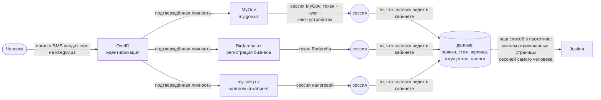

**Как устроены методы за OneID (наблюдения на живых порталах):**

| Сервис | Что видим в сети | Можем ли звать метод как внешний клиент |
| --- | --- | --- |
| MyGov | gRPC-Web (`/api/<сервис>/<Метод>`, protobuf), запросы **подписаны** ключом устройства из IndexedDB, ответы **зашифрованы** | Нет: без браузера человека подпись и расшифровка недоступны |
| Birdarcha | REST `api.birdarcha.uz` с Bearer-токеном | Технически да, но это внутренний недокументированный API, токен из браузера человека. Мы так не делаем |
| my.soliq.uz | REST `/api/cabinet-profile-api/...` внутри SPA | То же: внутренний API, не для сторонних |
| Vakolat.uz | Публичный JSON `GET api-vakolat.adliya.uz/v1/front/mandate/number/{№}` | **Да**, публичный, без входа |

**Вывод для разговора:** мы не «получаем заявки от OneID». Мы входим через OneID **как человек**, и дальше **читаем его кабинет его же сессией**. Это не интеграция по API, это автоматизация браузера под согласие владельца. Для прототипа это единственный способ показать ценность на живых данных. Для продукта — временное решение, см. раздел 8.

---

## 3. Контекстная диаграмма (As-Is, что работает сегодня)

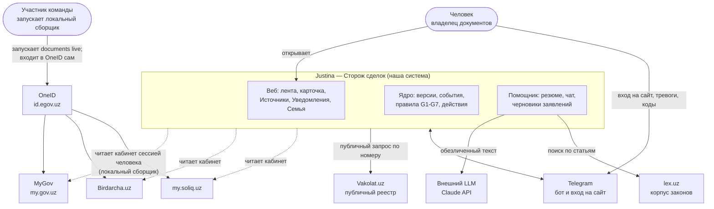

Пунктир — доступ через сессию человека (прототип). Сплошная линия — штатный канал.

---

## 4. Контейнерная диаграмма (как это развёрнуто)

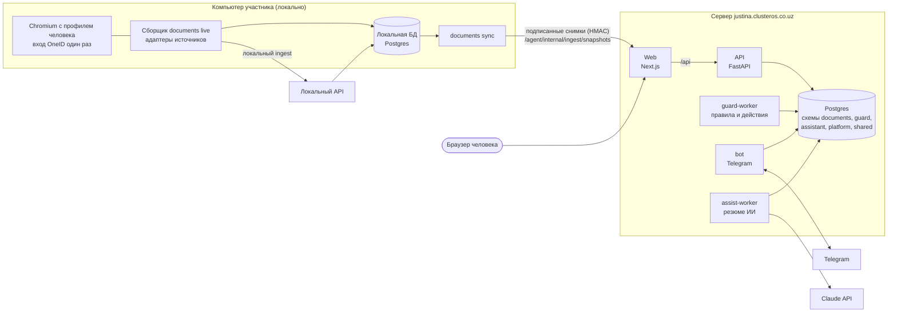

**Почему сборщик на компьютере, а не на сервере.** Сессия MyGov привязана к ключу устройства в браузере и меняет токен в куках, перенести её между запусками или на сервер нельзя (проверено: перенос даёт 403). Поэтому браузер с входом живёт у человека, а на сервер уходят **только нормализованные документы** (без ПИНФЛ и полных ФИО) подписанными снимками.

---

## 5. Конвейер: от записи в кабинете до тревоги в Telegram

Одинаков для всех источников. Источник можно заменить, остальное не меняется.

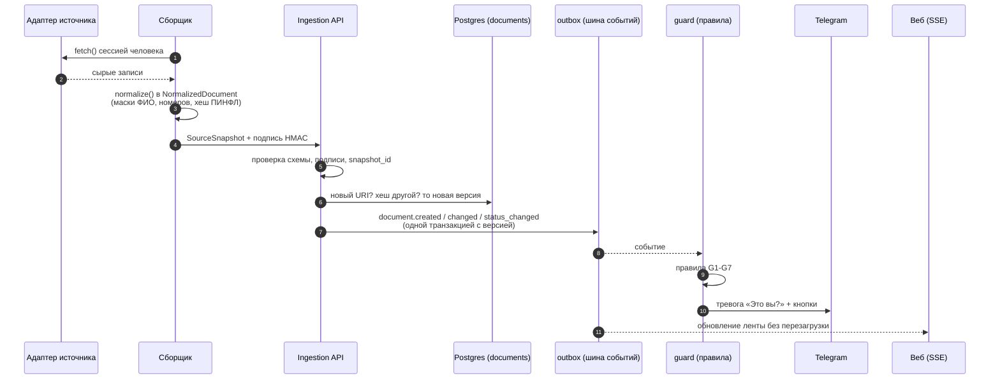

---

## 6. Как мы тянем каждый источник (диаграммы последовательности)

Общий приём для MyGov: открыть страницу сессией человека, **подождать, пока страница сама расшифрует свои данные и отрисует список**, прочитать готовые карточки. Мы не вызываем методы MyGov напрямую.

### 6.1 Подключение источников (вход один раз)

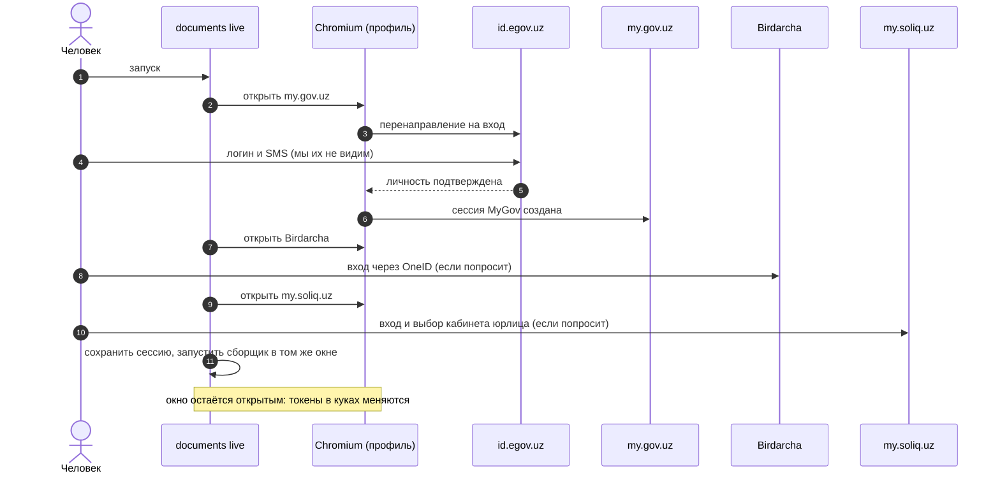

### 6.2 «Мои заявки» (`mygov.requests`, `mygov.car_poa`)

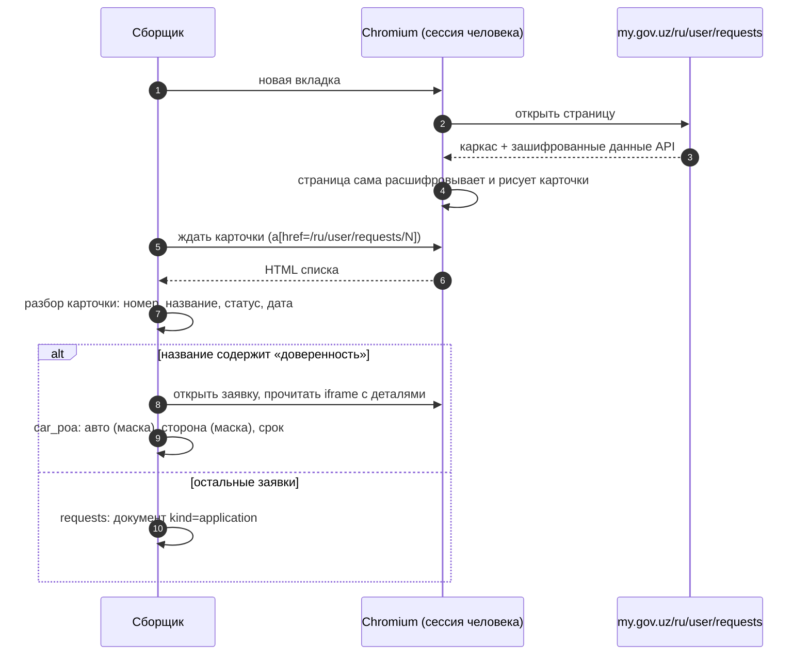

### 6.3 Уведомления (`mygov.notifications`)

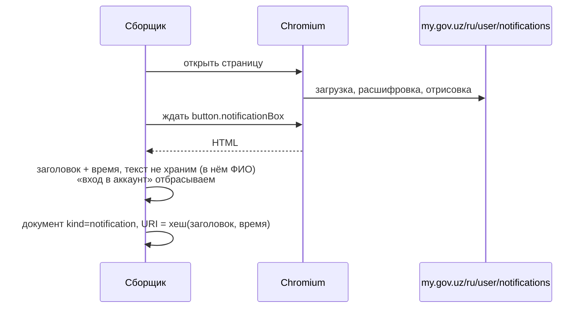

### 6.4 Стаж работы (`mygov.career`)

```mermaid
sequenceDiagram
    participant C as Сборщик
    participant CH as Chromium
    participant MG as my.gov.uz/ru/user/career
    C->>CH: открыть страницу
    CH->>MG: таблица «Информация о стаже работы»
    CH-->>C: HTML таблицы
    C->>C: строка = запись: организация, должность, отдел, даты
    C->>C: «До сих пор» → active; есть дата окончания → completed
    Note over C: документ kind=labor_contract;<br/>увольнение даст document.status_changed
```

### 6.5 Заявки на регистрацию юрлица (`birdarcha.applications`)

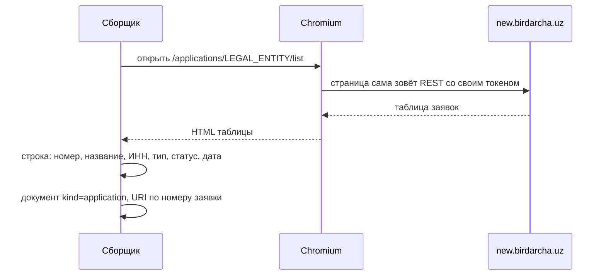

### 6.6 Юрлицо, учредители, имущество, налоги (`soliq.*`)

```mermaid
sequenceDiagram
    participant C as Сборщик
    participant CH as Chromium
    participant SQ as my.soliq.uz (кабинет юрлица)
    C->>CH: general_info/chartercapital
    SQ-->>CH: шапка (ИНН, название) + панели учредителей
    C->>C: soliq.company: kind=company, доли учредителей, имена масками
    C->>CH: nonresidentialproperty, landplots
    C->>C: soliq.property: kind=real_estate_right (кадастр маскируется)
    C->>CH: automobiles
    C->>C: soliq.vehicles: kind=vehicle (госномер: хеш в URI, маска в объекте)
    C->>CH: taxes
    C->>C: soliq.taxes: kind=tax_assessment; долг > 0 → active, владелец debtor
```

### 6.7 Проверка доверенности в реестре (`vakolat.check`)

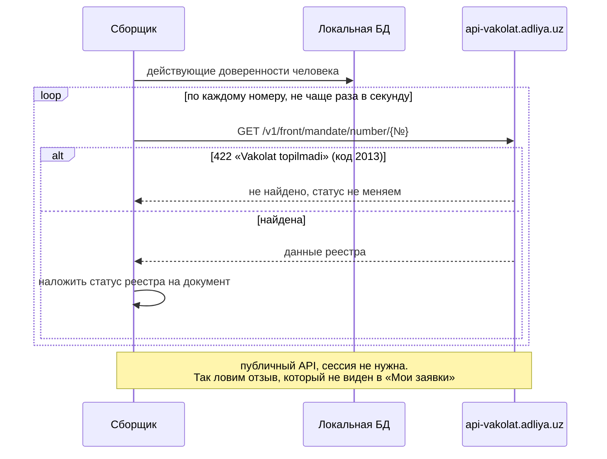

### 6.8 История нотариальных действий (`mygov.notarial_history`) — не реализовано

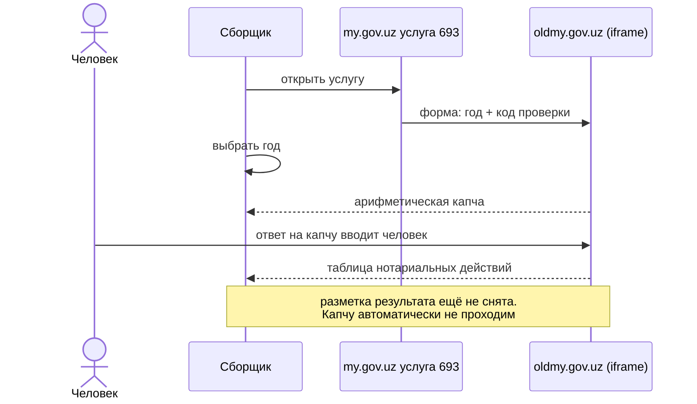

### 6.9 Синхронизация на сервер (`documents sync`)

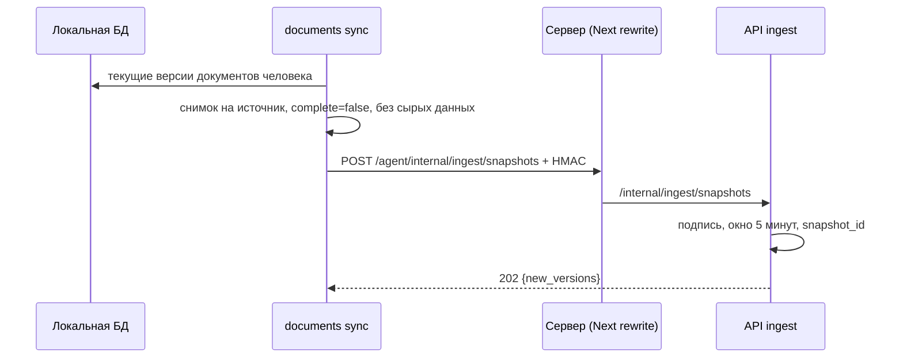

---

## 7. Каталог источников

| Источник | Адаптер | Вид документа | Как читаем | Живые данные у команды | Состояние |
| --- | --- | --- | --- | --- | --- |
| MyGov «Мои заявки» | `mygov.requests` | `application` | страница кабинета | да (8) | работает |
| MyGov e-доверенности на авто | `mygov.car_poa` | `poa_car` | страница + iframe | нет доверенности | парсер списка есть, детали проверены на макете |
| MyGov «Уведомления» | `mygov.notifications` | `notification` | страница | да (4) | работает |
| MyGov «Карьера» (стаж) | `mygov.career` | `labor_contract` | страница | да (6) | работает |
| Birdarcha | `birdarcha.applications` | `application` | страница | да (1) | работает |
| my.soliq.uz: юрлицо, учредители, доли | `soliq.company` | `company` | страница | да (1) | работает |
| my.soliq.uz: имущество, земля | `soliq.property` | `real_estate_right` | страница | таблицы пустые | работает на фикстурах |
| my.soliq.uz: транспорт | `soliq.vehicles` | `vehicle` | страница | таблицы пустые | колонки предположение |
| my.soliq.uz: налоги | `soliq.taxes` | `tax_assessment` | страница | таблицы пустые | работает на фикстурах |
| Vakolat.uz | `vakolat.check` | статус `poa_*` | публичный JSON | нет номера | формат успешного ответа не снят |
| Нотариальная история | `mygov.notarial_history` | `notarial_act`, `poa_notarial` | страница + капча | нет | не реализовано |

Волна B (долги МИБ, кредитная история КАТМ, авто МВД, E-ijara, ЭЦП, кадастр) пока не начата. Для неё официальные каналы — именно МИП.

---

## 8. To-Be: модуль внутри контура MyGov + МИП

**Идея:** Justina становится модулем «Мои документы» внутри MyGov. Тогда:
- вход и согласие человека даёт сам MyGov (человек уже авторизован в портале, второй вход не нужен);
- данные приходят **не из экранов кабинетов, а по каналам межведомственной интеграции**: MyGov имеет доступ к **МИП** (межведомственная интеграционная платформа, шина обмена между ведомствами), а через неё к реестрам: Минюст (Notarius, Vakolat), МВД, кадастр, налоговая, МИБ, КАТМ, Mehnat;
- доступ к методам Justina только после авторизации средствами MyGov (токен пользователя MyGov), права на чужие данные (семья) — через явное согласие.

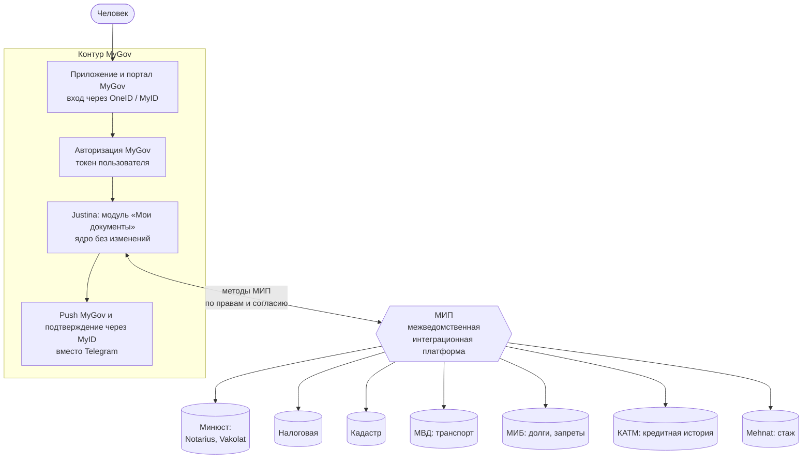

**Что меняется, а что нет:**

| Слой | Сегодня (прототип) | To-Be (контур MyGov + МИП) |
| --- | --- | --- |
| Вход человека | OneID, Telegram для входа на сайт | Сессия MyGov |
| Получение данных | Playwright читает кабинеты сессией человека | События и запросы через МИП, **тот же контракт `SourceSnapshot`** |
| Хранение сессий человека | Профиль браузера у участника команды | Не нужно вовсе |
| Задержка | опрос 20 с … 10 мин | подписка на события реестров, секунды |
| Уведомления и подтверждение | Telegram + код | Push MyGov, подтверждение через MyID |
| Ядро (версии, события, правила, ИИ, UI) | как есть | **не меняется** |
| Риски | вёрстка кабинетов, 403 при смене защиты, условия использования | зависят от согласования и прав в МИП |

Что нужно подтвердить с Минцифры и МИП (в открытом доступе документации по этим методам нет, поэтому это допущения): перечень доступных методов по человеку, модель согласия, режим «подписки на изменения» вместо опроса, юридическое основание для показа человеку данных о нём самом.

---

## 9. Какую ценность показывает прототип

Прототип отвечает на два вопроса, не зависящих от канала данных:

1. **Можно ли собрать картину «всё, что оформлено на меня» в одном месте?** Да: сегодня из пяти кабинетов в одной ленте (заявки, стаж, юрлицо с долями, уведомления, налоги и имущество юрлица), один формат, один поиск.
2. **Даёт ли это ценность?** Гипотезы продукта, которые прототип позволяет проверить:
   - человек видит **все** свои документы и обязательства (не нужно помнить, в каком кабинете что лежит);
   - появление или изменение записи видно за секунды-минуты, а не при случайном заходе;
   - для опасных случаев (чужая доверенность на авто) есть реакция: тревога, «Это не я», шаги отзыва, черновик заявления со ссылками на статьи закона.

Что прототип **не** доказывает: что МИП даст те же поля и права. Это отдельная задача интеграции, но ядро под неё уже готово.

---

## 10. Если ментор спросит: короткие ответы

| Вопрос | Ответ |
| --- | --- |
| «OneID вам ничего не даёт» | Верно: он даёт только вход. Данные дают сервисы за ним, и доступ к ним открывается сессией после входа через OneID. Мы это и говорим |
| «Какими методами вы тянете данные?» | В прототипе — автоматизация браузера под сессией самого человека, с его согласия, читаем то, что он видит в кабинете. Один источник (Vakolat) — публичный API. Прямые вызовы внутренних API MyGov невозможны: запросы подписаны ключом устройства, ответы зашифрованы |
| «Это же хрупко» | Да, поэтому весь код чтения изолирован в адаптерах (`selectors.py` и тесты на фикстурах), а ядро ничего не знает об источнике. Адаптер заменяется без переписывания продукта |
| «Это законно?» | Только аккаунты участников команды и только с их согласия; пароль и SMS вводятся на id.egov.uz, мы их не видим; в БД маски и хеши, сырое шифруется ключом гражданина |
| «Что в продукте?» | Контекст «Документы» (агрегация), «Сторож» (тревоги и действия), «Помощник» (ИИ) и платформа. Читайте `ARCHITECTURE.md` |
| «Как это масштабируется?» | Через МИП внутри контура MyGov: тот же `SourceSnapshot`, адаптеры заменяются на потребителей событий МИП |
| «Что дальше?» | Волна B (МИБ, КАТМ, транспорт, аренда, ЭЦП, кадастр) и согласование каналов в МИП |

---

## 11. Ограничения прототипа (честно)

- Доступ к данным держится на сессии человека и разметке кабинетов; смена защиты или вёрстки ломает адаптер.
- Сессия MyGov живёт в браузере человека; сборщик нельзя запустить «на сервере сам по себе».
- Нет живых доверенностей на авто: этот сценарий проверен на тестовом макете `my.gov.uz`, а не на настоящем кабинете.
- Нотариальная история не реализована (капча проходится человеком).
- В ленте у юрлица пока нет имущества и налогов: у нашей компании их нет.
