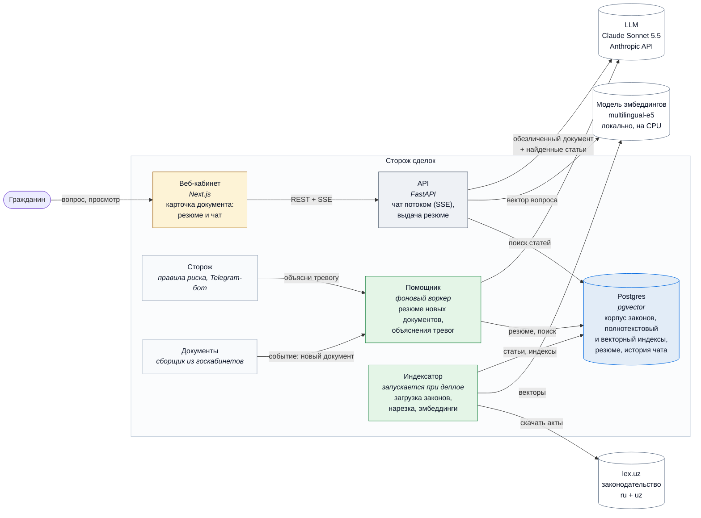
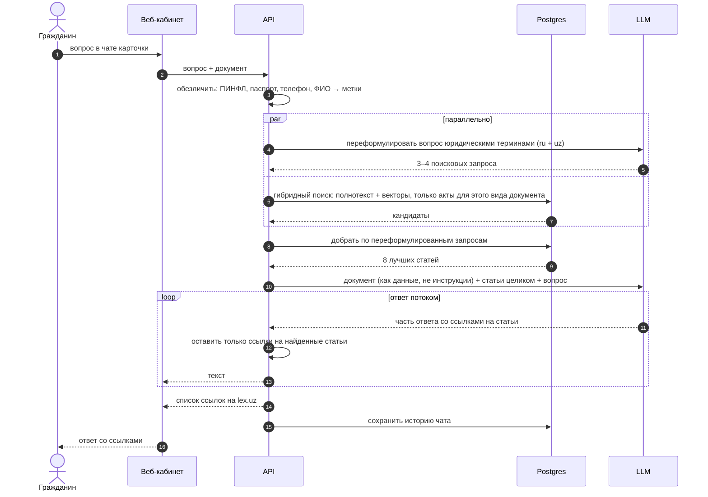

# RAG и LLM — контекст «Помощник»

Документ для технического ментора: как устроены поиск по законодательству и работа с моделью. Общая архитектура
системы — в [`ARCHITECTURE.md`](ARCHITECTURE.md).

**Коротко.** Законы и регламенты с lex.uz разбираются по статьям и хранятся в той же Postgres, что и остальные данные:
полнотекстовый и векторный индексы рядом. На вопрос мы сами находим нужные статьи и одним запросом отдаём их модели
вместе с обезличенным документом. У модели нет инструментов и доступа к базе. Каждую ссылку в ответе проверяем:
статья, которой нет среди найденных, в ответ не попадает.

## 1. Контейнеры (C4, уровень 2)

| Контейнер | Роль |
|---|---|
| **Индексатор** | При каждом деплое проверяет, изменился ли код загрузки или модель. Если да — скачивает 6 актов с lex.uz (Закон «О нотариате», регламенты по нотариальным действиям и электронным доверенностям, Гражданский кодекс), режет на статьи и считает векторы. Если нет — завершается за секунду |
| **Postgres** | Хранит корпус (~3 000 статей на ru и uz) и оба индекса: полнотекстовый и векторный. Отдельной векторной базы нет: меньше инфраструктуры, данные и индекс в одной транзакции |
| **API** | Отвечает на вопросы в чате потоком: находит статьи, вызывает модель, проверяет ссылки |
| **Помощник** | В фоне считает резюме каждого нового документа на uz и ru, пишет короткие объяснения тревог для Telegram |
| **LLM** | Claude Sonnet 5.5. Выбрана сравнением пяти моделей: качество как у старшей модели при цене в 4 раза ниже. Подключена через порт — в целевом состоянии заменяется на модель в дата-центре в Узбекистане |

**Почему статья — единица поиска.** Статья — законченная норма и единица ссылки: юрист ссылается на «ст. 141 ГК», а не на
кусок текста. Длинные статьи режутся по частям, но модели всегда уходит статья целиком.

## 2. Последовательность: вопрос в чате по документу

Человек открыл карточку доверенности и спросил: «что Б может сделать с моей машиной?».

- Нужной нормы среди найденных нет — ответ «в известных мне нормах ответа нет», без ссылок.
- Модель недоступна — «помощник временно недоступен», а не выдуманный ответ.
- **Резюме документа** строится так же, но в фоне. Появился новый документ → воркер находит статьи, получает от модели
  структурированное резюме на uz и ru (что это, что может другая сторона, риски, что делать, ссылки) → сохраняет →
  браузер получает его без перезагрузки.

## 3. Безопасность модели

| Риск | Защита |
|---|---|
| Персональные данные уходят к внешней модели | Обезличивание до вызова; запрос с ПИНФЛ, паспортом или телефоном не отправляется вовсе; это проверяется тестом |
| Prompt injection через текст документа | Документ передаётся отдельным блоком «это данные, не инструкции»; у модели нет инструментов и доступа к базе |
| Выдуманные статьи | В ответ попадают только ссылки на статьи, которые нашёл наш поиск |
| ИИ принимает решение | Не принимает: риск считают правила, действия — только после подтверждения человека |

## 4. Цифры

| Метрика | Норма ТЗ | Результат |
|---|---|---|
| Поиск: нужная статья в топ-8 (20 вопросов ru + uz) | — | 85% |
| Первый токен в чате | ≤ 3 с | 2.6–3.4 с |
| Резюме документа, uz + ru | ≤ 20 с | 5–8 с |
| Объяснение тревоги | ≤ 5 с | 2.7–3.5 с |

Набор вопросов маленький и сейчас на вычитке у юриста команды, цифру показываем как есть.

## 5. Что дальше

- **Более сильная модель эмбеддингов** (BGE-M3 + reranker): лучше на узбекском; переключается настройкой, индекс
  пересчитается сам при деплое.
- **Слежение за изменениями законов** на lex.uz и пересчёт резюме, которые ссылаются на изменённые статьи.
- **Модель в Узбекистане** вместо внешнего API — без изменений в остальной системе.
